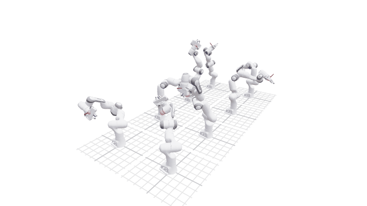

# BetterRobot

PyTorch-native robotics. Load a URDF or MJCF robot, run batched forward kinematics, Jacobians and rigid-body
dynamics with autograd through every step, and solve inverse kinematics, trajectories and motion fits with one
least-squares optimiser over named tensors. Fixed- and floating-base robots share one API, and a browser viewer
plays whole clips.



Documentation: [rihat99.github.io/BetterRobot](https://rihat99.github.io/BetterRobot/) — or build it locally
with `uv run mkdocs serve`.

## Install

Requires [uv](https://docs.astral.sh/uv/):

```bash
git clone https://github.com/rihat99/BetterRobot
cd BetterRobot
uv sync                                               # torch, numpy, URDF loading
uv sync --extra demos --extra viewer --extra meshes   # example robots, browser viewer, mesh rendering
uv sync --extra dev                                   # tests, benchmarks, docs, lint
```

## Solve 64 IK problems at once

```python
import torch
from robot_descriptions import panda_description

import better_robot as br
from better_robot import terms

model = br.load(panda_description.URDF_PATH, dtype=torch.float64)

# 64 reachable hand poses: forward kinematics of random configurations.
generator = torch.Generator().manual_seed(0)
q0 = model.q_neutral.clamp(model.lower_pos_limit, model.upper_pos_limit).expand(64, -1)
targets = model.fk(terms.random_start(model, q0, generator=generator)).frame_pose_of("body_panda_hand")

# One batched solve, then check every answer with forward kinematics.
result = terms.solve_ik(model, {"body_panda_hand": targets}, q0=q0, restarts=4, generator=generator)
reached = model.fk(result["q"]).frame_pose_of("body_panda_hand")
print(float((reached[:, :3] - targets[:, :3]).norm(dim=-1).median()))
```
```output
3.1075885246701783e-12
```

`model.fk(q)` returns a frozen `KinematicState`; Jacobians and dynamics are functions of that state. Poses are
`[tx, ty, tz, qx, qy, qz, qw]` (scalar last). The median position error over the 64 solves is at machine
precision.

## Where next

- [Getting started](https://rihat99.github.io/BetterRobot/getting-started/) — from loading a robot to batched IK,
  trajectories and the viewer, one step at a time.
- [Architecture](https://rihat99.github.io/BetterRobot/concepts/architecture/) — the layers and how one call
  flows through them.
- [Examples](examples/) — `uv run python examples/01_ik.py` opens a viewer where the Panda follows a gizmo.

## Development

```bash
uv run pytest tests -q -m "not bench and not cuda"
uv run ruff check src tests
uv run mkdocs build --strict
```

Pinocchio parity tests (`tests/test_pinocchio/`) are the numerical oracle.

## License

Apache License 2.0 ([LICENSE](LICENSE)). Copyright 2026 BetterRobot contributors.
