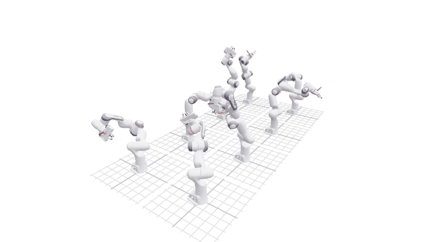

# BetterRobot

PyTorch-native robotics. Load a URDF or MJCF robot, run batched forward kinematics, Jacobians and rigid-body
dynamics with autograd through every step, and solve inverse kinematics, trajectories and motion fits with one
least-squares optimiser over named tensors. Fixed- and floating-base robots share one API, and a browser viewer
plays whole clips.



Documentation: [rihat99.github.io/BetterRobot](https://rihat99.github.io/BetterRobot/) (locally: `uv run mkdocs serve`).

## Install with [uv](https://docs.astral.sh/uv/)

```bash
git clone https://github.com/rihat99/BetterRobot && cd BetterRobot
uv sync --extra demos              # torch, numpy, URDF loading, the example robots
uv sync --all-extras --all-groups  # plus viewer, meshes, MJCF, tests, oracles, benchmarks, docs, lint
```

## Solve 64 IK problems at once

```python
import torch
from robot_descriptions import panda_description

import better_robot as br
from better_robot import terms

model = br.load(panda_description.URDF_PATH, dtype=torch.float64)
generator = torch.Generator().manual_seed(0)
q0 = model.q_neutral.expand(64, -1)
# 64 reachable hand poses from random configurations, one batched solve, and forward kinematics checks every answer.
targets = br.forward_kinematics(model, terms.random_start(model, q0, generator=generator)).frame_pose_of("panda_hand")
result = terms.solve_ik(model, {"panda_hand": targets}, q0=q0, restarts=4, generator=generator)
reached = br.forward_kinematics(model, result.x["q"]).frame_pose_of("panda_hand")
print(float((reached[:, :3] - targets[:, :3]).norm(dim=-1).median()))
```
```output
3.1075885246701783e-12
```

`br.forward_kinematics(model, q)` returns a frozen `KinematicState`; Jacobians and dynamics are functions of that state. Poses are
`[tx, ty, tz, qx, qy, qz, qw]` (scalar last). The median position error over the 64 solves is at machine
precision.

## Where next

- [Getting started](https://rihat99.github.io/BetterRobot/getting-started/) — from loading a robot to batched IK,
  trajectories and the viewer, one step at a time.
- [Architecture](https://rihat99.github.io/BetterRobot/concepts/architecture/) — the layers and how one call
  flows through them.
- [Examples](examples/) — `uv run python examples/01_ik.py` opens a viewer where the Panda follows a gizmo.

## Development

```bash
uv run pytest tests -q -m "not bench and not cuda"
uv run ruff check src tests
uv run mkdocs build --strict
```

Pinocchio parity tests (`tests/parity/pinocchio/`) are the numerical oracle.

## License

Apache License 2.0 ([LICENSE](LICENSE)). Copyright 2026 BetterRobot contributors.
