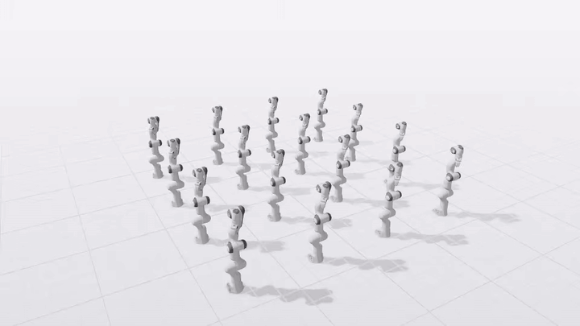

# BetterRobot

BetterRobot is a PyTorch library for batched, differentiable robot kinematics, dynamics and optimisation.



> **Status:** this is an early version (0.1.0) in active development, and breaking changes may happen. Development happens on the `dev` branch.

## Install

```bash
git clone https://github.com/rihat99/BetterRobot && cd BetterRobot
uv sync --all-extras   # Python 3.12+, PyTorch, and the viewer, MJCF, mesh and demo extras
```

## Quickstart

```python
import torch
from robot_descriptions import panda_description
import better_robot as br

model = br.load(panda_description.URDF_PATH, dtype=torch.float64)
generator = torch.Generator().manual_seed(0)
q0 = model.q_neutral.expand(64, -1)                             # (64, nq): a batch of 64 configurations
q = br.terms.random_start(model, q0, generator=generator)       # 64 random configurations within the limits

state = br.forward_kinematics(model, q)                         # every joint and frame pose, for the whole batch
hand = state.frame_pose_of("panda_hand")                        # (64, 7): [tx, ty, tz, qx, qy, qz, qw]
jacobian = br.frame_jacobian(model, state, frame="panda_hand")  # (64, 6, nv), rows [linear, angular]
print(hand.shape, jacobian.shape)

result = br.solve_ik(model, {"panda_hand": hand}, q0=q0, seeds=8, generator=generator)  # 64 IK problems, one call
reached = br.forward_kinematics(model, result.x["q"]).frame_pose_of("panda_hand")
print(f"median hand error after IK: {(reached[:, :3] - hand[:, :3]).norm(dim=-1).median():.1e} m")
```
```output
torch.Size([64, 7]) torch.Size([64, 6, 8])
median hand error after IK: 5.0e-13 m
```

Every function keeps the leading batch axes of its inputs, and gradients flow through every call. Show the 64
answers in the browser viewer as a clip, one answer per frame:

```python
from better_robot.viewer import RobotVisual

viewer = br.Viewer()  # a local viser server: open viewer.url in a browser
geometry = br.io.load_geometry(panda_description.URDF_PATH, model)
viewer.add(RobotVisual(model, result.x["q"], geometry=geometry, root=panda_description.URDF_PATH))
viewer.serve()  # plays the clip until Ctrl-C
```

## What is inside

| Package | What it does |
|---|---|
| `io` | Reads URDF and MJCF files into a `Model`; `ModelBuilder` builds one in code. |
| `model` | The robot as one frozen record of tensors: joints, bodies, frames and geometry. |
| `kinematics` | Forward kinematics, frame and joint Jacobians, `integrate` and `difference`, and `compiled`, the opt-in `torch.compile` path. |
| `dynamics` | Inverse and forward dynamics, the mass matrix, the centre of mass and centroidal momentum. |
| `lie`, `spatial` | SE(3) and SO(3) operations; twists, wrenches and inertias. Plain torch functions. |
| `optim` | Least squares over named tensors: Gauss-Newton, Levenberg-Marquardt, sequential QP, L-BFGS. It knows nothing about robots. |
| `terms` | Robot costs for `optim` (pose targets, joint limits, clearance, manipulability) and `solve_ik`. |
| `collision` | Signed distances between spheres, capsules, boxes, planes and voxel grids; a robot as spheres or capsules. |
| `viewer` | A browser viewer on [viser](https://viser.studio): robots, clips, points and meshes on one timeline, and video recording. |

`exceptions` holds the error classes, and `testing` the checks that BetterRobot and the projects built on it share.

## How it compares

Four other libraries cover parts of the same ground. Every cell was checked against the project's own
documentation and code in November 2026; corrections are welcome.

| | BetterRobot | [Pinocchio](https://github.com/stack-of-tasks/pinocchio) | [frax](https://github.com/StanfordASL/frax) | [PyRoki](https://github.com/chungmin99/pyroki) | [cuRobo](https://github.com/NVlabs/curobo) |
|---|---|---|---|---|---|
| What it is for | kinematics, dynamics and optimisation in batches | fast kinematics and dynamics, and their gradients | kinematics and dynamics for robot controllers | inverse kinematics and trajectory optimisation | collision-free motion planning |
| Built on | PyTorch | C++, with Python bindings | JAX | JAX | PyTorch, CUDA, Warp |
| Runs on | CPU, GPU | CPU | CPU, GPU, TPU | CPU, GPU, TPU | NVIDIA GPU only |
| Batches in one call | yes | partly (some functions, on CPU threads) | yes (with `jax.vmap`) | yes | yes |
| Gradients | yes (automatic) | yes (automatic or hand-derived) | yes (automatic) | yes (automatic or hand-derived) | partly (kinematics) |
| Robot files | URDF, MJCF | URDF, MJCF, SDF, SRDF | URDF | URDF | URDF |
| Floating base (humanoids, quadrupeds) | yes | yes | yes | partly (base pose as an extra variable) | partly (base as six extra joints) |
| Dynamics (torques, mass matrix) | yes | yes | yes | no | partly (torque limits in planning) |
| Inverse kinematics | yes | no (add-ons: LoIK, PlaCo) | yes | yes | yes |
| Trajectory optimisation | yes | no (add-ons: Aligator, Crocoddyl) | no | yes | yes |
| Collision shapes | spheres, capsules, boxes, planes, voxel grids | meshes and basic shapes (through Coal) | spheres only | spheres, capsules, planes, height maps | spheres, capsules, boxes, cylinders, meshes, voxel grids |
| Viewer | yes (viser) | yes (Meshcat, viser and others) | no (its examples use viser) | yes (viser) | yes (viser) |
| Licence | Apache-2.0 | BSD-2-Clause | MIT | MIT | Apache-2.0 |

Speed, in microseconds per configuration, float64, on one core of an AMD EPYC 9654 with PyTorch 2.13 (measured
2026-11-20). The Panda here has its fingers fixed (7 joints); the Unitree G1 has a floating base (35 velocities).

| | Pinocchio, one call | BetterRobot, batch 1, not compiled | BetterRobot, batch 4096, compiled |
|---|--:|--:|--:|
| **Panda** | | | |
| Forward kinematics | 0.39 | 110 | 0.25 |
| Frame Jacobian | 0.76 | 200 | 0.84 |
| Inverse dynamics | 1.4 | 440 | 1.8 |
| Mass matrix | 0.92 | 380 | 5.4 |
| Forward dynamics | 4.2 | 690 | 7.1 |
| **Unitree G1** | | | |
| Forward kinematics | 1.3 | 190 | 2.4 |
| Frame Jacobian | 1.2 | 280 | 4.2 |
| Inverse dynamics | 5.0 | 530 | 10 |
| Mass matrix | 4.5 | 480 | 26 |
| Forward dynamics | 18 | 820 | 40 |

For one configuration at a time, Pinocchio is the faster choice: 45 to 420 times faster here, because every PyTorch
call carries a fixed overhead. BetterRobot is built for batches: with 4096 configurations in one compiled call
(`kinematics.compiled`), its cost per configuration runs from 0.6 times Pinocchio's (Panda forward kinematics) to 6
times (mass matrix). Compiling takes 2 to 16 seconds per function and batch size. The table has no GPU column; with
`--device cuda`, the command that measured it measures one:

```bash
uv sync --all-extras --all-groups
uv run python benchmarks/speed.py run --device cpu --dtype float64 --robots panda7,g1 --batches 1,4096 \
  --functions forward_kinematics,frame_jacobian,inverse_dynamics,mass_matrix,forward_dynamics --modes eager,compile
```

## Documentation and related projects

- The documentation starts at [docs/index.md](docs/index.md); `uv run mkdocs serve` serves it as a site.
- [examples/](examples/) holds short programs, from batched inverse kinematics to dynamics and the viewer.
- [BetterHuman](https://github.com/rihat99/BetterHuman) builds SMPL-family human body models on BetterRobot.

## Licence

Apache License 2.0 ([LICENSE](LICENSE)). Copyright 2026 BetterRobot contributors.
