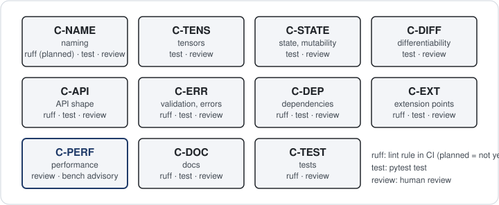

# Packages form a strict layering

After this page you know which package does what, how one call such as `model.fk(q)` travels through
them, what counts as public API, where inputs are validated, and where the written rules live. Read it
before you add a module or move a function.

## Each package sits on one rank, and imports only point down

{ width=760 }

*Each package imports only from its own row or the rows below; nothing imports the viewer.*

A module may import from its own rank or any lower rank, never from a higher one. The ranks live in
`tests/contract/test_layer_dependencies.py`, which parses every source file and fails on an upward import.

| Rank | Package | Job |
|------|---------|-----|
| 7 | `viewer` | interactive 3-D display; nothing imports it |
| 6 | `terms` | robot cost terms (poses, limits, collision) and `solve_ik` |
| 5 | `io`, `kinematics`, `dynamics`, `collision` | model building; FK and Jacobians; RNEA, CRBA, centroidal; distances |
| 4 | `data_model` | `Model`, `ModelStructure`, `ModelValues`, joint models, bodies, frames |
| 3 | `spatial`, `optim` | 6-D motion, force and inertia algebra; robot-agnostic least squares |
| 2 | `lie` | SO(3) and SE(3) formulas on plain tensors |
| 1 | `_typing` | shared type aliases |

Packages on one rank may import each other, so `dynamics` reuses the raw forward-kinematics helpers of
`kinematics`. `optim` imports only `torch`: it knows nothing about robots, and `terms` adapts robots to it.
Imports guarded by `TYPE_CHECKING` are exempt because they never run.

The layering buys three things. The core (`lie` up to `dynamics`) never loads optional dependencies such as
`viser`, so `import better_robot` stays light. A lower layer can change its internals without breaking a
higher one, which sees only public names. And the tests of one layer need only the layers below it.

## One call crosses the layers once, and checks its input once

Follow `model.fk(q)` from the top. It is the same function as `br.forward_kinematics_state(model, q)`.

```python
import torch
import better_robot as br

builder = br.ModelBuilder("two_link")
builder.add_body("base"); builder.add_body("upper"); builder.add_body("lower")
builder.add_revolute_z("shoulder", parent="base", child="upper")
builder.add_revolute_z("elbow", parent="upper", child="lower")
model = br.io.build_model(builder.finalize())

q = torch.rand(4, model.nq)                        # a batch of 4 configurations
state = model.fk(q)
print(model.nq, model.structure.njoints)
print(tuple(state.joint_transform.shape))
print(tuple(state.frame_pose_of("body_lower").shape))
```
```output
2 4
(4, 4, 3, 4)
(4, 7)
```

Two coordinates, but four joints: `universe` and a fixed `root_joint` that attaches `base` come before
`shoulder` and `elbow`. Seven steps happened, from the public boundary down to plain tensor algebra:

1. `Model.fk` lives in `data_model` (rank 4) but the function it calls lives in `kinematics` (rank 5). It
   imports it lazily inside the method, so the module-level import graph still points down only.
2. `forward_kinematics_state` validates `q`: trailing size `nq`, dtype and device against `model.values`.
   This is the only check on the whole path.
3. The leading batch axes of `q` and of the model's values broadcast together (here `(4,)`).
4. `expand_configuration` fills mimic joints, giving the full configuration `q_full`.
5. `placement_matrices` turns the joint placements $M_j$ and frame placements $F_f$ into 4×4 matrices.
6. The raw pass `lean_core` (in `kinematics._fk_lean`, no checks) walks the tree in topological order:

    $$T_{0j} = T_{0\lambda(j)}\, M_j\, X_j(q_j), \qquad T_{0f} = T_{0\,p(f)}\, F_f$$

    where $T_{0j}$ is the world pose of joint $j$, $\lambda(j)$ its parent joint, $X_j(q_j)$ the joint's own
    motion, and $p(f)$ the parent joint of frame $f$.

7. The result is a frozen `KinematicState` holding `joint_transform` `(B..., njoints, 3, 4)` and
   `frame_transform` `(B..., nframes, 3, 4)`. `state.frame_pose_of(name)` reads one frame as a 7-vector
   `[tx, ty, tz, qx, qy, qz, qw]`.

Every later query takes that state instead of `q`: `frame_jacobian(model, state, frame=...)`,
`inverse_dynamics(model, state, v=..., a=...)`, the terms in `better_robot.terms`. So the check in step 2 runs
once per configuration, not once per query.

## Inputs are validated once, at the boundary

!!! note "Contract"
    Public functions check the structure of their inputs: trailing shapes (`q (B..., nq)`,
    `v (B..., nv)`), dtype and device against the model's values. A violation raises a typed error from
    `better_robot.exceptions` (for example `ShapeError` or `DtypeMismatchError`) that names the argument.
    The raw passes below them trust validated inputs.

- No silent casts or moves. A `float32` model with a `float64` `q` is an error, not a conversion.
- Values are not scanned. Public functions do not test tensors for NaN or infinity; that would cost a
  device synchronisation on every call.
- Broadcasting follows PyTorch. Leading batch axes broadcast; trailing event axes must match exactly.

```python
try:
    model.fk(torch.zeros(5))                       # wrong trailing size: nq is 2
except br.exceptions.ShapeError as error:
    print(type(error).__name__)
```
```output
ShapeError
```

## Public API is what `__all__` lists

The root namespace is deliberately small. `better_robot.__all__` holds the core of most scripts: `Model`,
`ModelStructure`, `ModelValues`, `Joint`, `Body`, `Frame`, `load`, `ModelBuilder`,
`forward_kinematics_state`, `KinematicState`, `frame_jacobian`, `joint_jacobian`, their time variations,
`center_of_mass`, `inverse_dynamics`, `mass_matrix`, `forward_dynamics`, `centroidal_map`,
`centroidal_momentum` and `SE3`. The subpackages `br.io`, `br.spatial` and `br.exceptions` are attributes
of the root; `tests/contract/test_public_api.py` checks this core.

Everything else is public only under its package name and only if that package's `__all__` lists it, for
example `better_robot.lie.so3` or `better_robot.optim.solve`. Names with a leading underscore, or missing
from `__all__`, can change without a deprecation. The [API reference](../reference/api/better_robot.md)
documents each package's `__all__`.

```python
import better_robot.kinematics.state as kinematics_state

print(br.forward_kinematics_state is kinematics_state.forward_kinematics_state)
print("ModelValues" in br.__all__)
```
```output
True
True
```

## Every rule has an ID and a check

{ width=760 }

*Each contract page owns a family of rule IDs (`C-<PAGE>-<n>`); each rule names the test, lint or review that enforces it.*

This page explains the design; the [contracts](../contracts/00-index.md) state it as rules. The layering
above is `C-DEP`, the boundary checks and typed errors are `C-ERR`, and the frozen state is `C-STATE`. When a rule and
this page disagree, the rule wins and this page has a bug.

## Where next

- [Model and state](model-and-state.md): the two objects every function takes.
- [Lie groups and spatial algebra](lie-and-spatial.md): the conventions the bottom two ranks fix.
- [Design contracts](../contracts/00-index.md): the full rule list with its checks.
- [Roadmap](../reference/roadmap.md): what landed in this version and what comes next, per theme.
