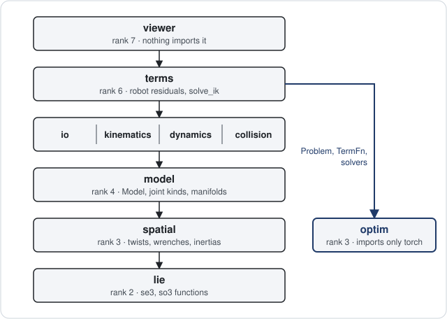
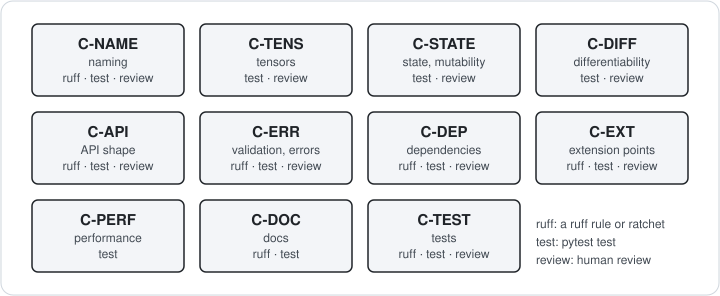

# Packages form a strict layering

After this page you know which package does what, how one call such as `br.forward_kinematics(model, q)` travels through
them, what counts as public API, where inputs are validated, and where the written rules live. Read it
before you add a module or move a function.

## Each package imports only the packages of its row

{ width=760 }

*Each band imports only from bands below it; the edge table below is exact. No package imports `viewer`, `terms`
or `testing`, and the private `_internal_checks`, which only `io` imports, is left out.*

The edge table is the `ALLOWED` dictionary of `tests/contract/test_layer_dependencies.py`, which parses every source
file (imports inside functions and under `TYPE_CHECKING` included) and fails on an import its row does not list.
This copy is checked against it by `tests/docs/test_codemap.py`:

```text
exceptions        -> nothing
_internal_checks  -> nothing
lie               -> exceptions
spatial           -> exceptions lie
model             -> exceptions lie spatial
kinematics        -> exceptions lie model
dynamics          -> exceptions lie spatial model kinematics
collision         -> exceptions lie model kinematics
io                -> exceptions _internal_checks lie model
optim             -> exceptions
terms             -> exceptions lie model kinematics collision optim
viewer            -> exceptions lie model kinematics collision
testing           -> exceptions model optim
```

| Package | Job |
|---------|-----|
| `lie`, `spatial` | SO(3) and SE(3) formulas; 6-D motion, force and inertia algebra, on plain tensors |
| `model` | `Model` (one flat frozen record), joint kinds, `Geometry` |
| `io` | URDF and MJCF loading, `ModelBuilder`, `build_model` |
| `kinematics`, `dynamics`, `collision` | FK and Jacobians; RNEA, CRBA, ABA, centroidal; distances |
| `optim` | robot-agnostic least squares and minimisation over named tensors |
| `terms` | robot cost terms (poses, limits, collision) and `solve_ik` |
| `viewer` | interactive 3-D display |
| `testing` | checks shared with BetterHuman's tests: the snippet runner, the fake viser server, the sweeps |

What the table rules out, each absence with its check:

- No row names `viewer`, `terms` or `testing`: nothing in the library imports them
  (`tests/contract/test_layer_dependencies.py`).
- `optim` imports only `exceptions` inside the package and torch outside it: it knows nothing about robots, and
  `terms` adapts robots to it (`tests/contract/test_optional_imports.py`).
- Importing `better_robot` loads no optional package; `viser` loads when a `Viewer` starts a server
  (`tests/contract/test_optional_imports.py`).

The layering buys three things. The core (`lie` up to `dynamics`) never loads optional dependencies such as
`viser`, so `import better_robot` stays light. A lower layer can change its internals without breaking a
higher one, which sees only public names. And the tests of one layer need only the layers below it.

## One call crosses the layers once, and checks its input once

Follow `br.forward_kinematics(model, q)` from the top.

```python
import torch
import better_robot as br

builder = br.ModelBuilder("two_link")
builder.add_body("base"); builder.add_body("upper"); builder.add_body("lower")
builder.add_revolute("shoulder", axis=(0.0, 0.0, 1.0), parent="base", child="upper")
builder.add_revolute("elbow", axis=(0.0, 0.0, 1.0), parent="upper", child="lower")
model = br.io.build_model(builder.finalize())

q = torch.rand(4, model.nq)                        # a batch of 4 configurations
state = br.forward_kinematics(model, q)
print(model.nq, model.njoints)
print(tuple(state.joint_transforms.shape))
print(tuple(state.frame_pose_of("lower").shape))
```
```output
2 4
(4, 4, 3, 4)
(4, 7)
```

Two coordinates, but four joints: `universe` and a fixed `root_joint` that attaches `base` come before
`shoulder` and `elbow`. Six steps happened, from the public boundary down to plain tensor algebra:

1. `forward_kinematics` validates `q`: trailing size `nq`, dtype and device against the model's.
   This is the only check on the whole path.
2. The leading batch axes of `q` and of the model's values broadcast together (here `(4,)`).
3. `full_configuration` fills mimic joints, giving the full configuration `q_full`.
4. `placement_matrices` turns the joint placements $M_j$ and frame placements $F_f$ into 4×4 matrices.
5. The raw pass `world_transforms` (in `kinematics._fk`, no checks) walks the tree in topological order:

    $$T_{0j} = T_{0\lambda(j)}\, M_j\, X_j(q_j), \qquad T_{0f} = T_{0\,p(f)}\, F_f$$

    where $T_{0j}$ is the world pose of joint $j$, $\lambda(j)$ its parent joint, $X_j(q_j)$ the joint's own
    motion, and $p(f)$ the parent joint of frame $f$.

6. The result is a frozen `KinematicState` holding `joint_transforms` `(B..., njoints, 3, 4)` and
   `frame_transforms` `(B..., nframes, 3, 4)`. `state.frame_pose_of(name)` reads one frame as a 7-vector
   `[tx, ty, tz, qx, qy, qz, qw]`.

Every later query takes that state instead of `q`: `frame_jacobian(model, state, frame=...)`,
`inverse_dynamics(model, state, v=..., a=...)`, the terms in `better_robot.terms`. So the check in step 1 runs
once per configuration, not once per query.

## Inputs are validated once, at the boundary

!!! note "Contract"
    Public functions check the structure of their inputs: trailing shapes (`q (B..., nq)`,
    `v (B..., nv)`), dtype and device against the model's values. A violation raises a typed error from
    `better_robot.exceptions` (for example `ShapeError` or `DtypeMismatchError`) that names the argument.
    The raw passes below them trust validated inputs.

- No silent casts or moves. A `float32` model with a `float64` `q` is an error, not a conversion.
- Values are not scanned. Public functions do not test tensors for NaN or infinity; that would cost a
  device synchronisation on every call.
- Broadcasting follows PyTorch. Leading batch axes broadcast; trailing event axes must match exactly.

```python
try:
    br.forward_kinematics(model, torch.zeros(5))   # wrong trailing size: nq is 2
except br.exceptions.ShapeError as error:
    print(type(error).__name__)
```
```output
ShapeError
```

## Public API is what `__all__` lists

The root namespace is deliberately small (decision record 0019). `better_robot.__all__` lists the twelve
subpackages (`exceptions`, `lie`, `spatial`, `model`, `kinematics`, `dynamics`, `collision`, `io`, `optim`, `terms`,
`viewer`, `testing`) and the fourteen names a first script needs: `load`, `Model`, `ModelBuilder`, `JointFreeFlyer`,
`forward_kinematics`, `KinematicState`, `frame_jacobian`, `joint_jacobian`, `inverse_dynamics`, `mass_matrix`,
`forward_dynamics`, `center_of_mass`, `solve_ik` and `Viewer`. Importing the root imports no optional package;
`Viewer` loads viser when it starts a server. `tests/contract/test_public_surface.py` checks this list.

Everything else is public only under its package name and only if that package's `__all__` lists it, for
example `better_robot.lie.so3` or `better_robot.optim.solve`. Names with a leading underscore, or missing
from `__all__`, can change without a deprecation. The [API reference](../reference/api/better_robot.md)
documents each package's `__all__`.

```python
from better_robot import kinematics

print(br.forward_kinematics is kinematics.forward_kinematics)
print("Model" in br.__all__)
```
```output
True
True
```

## Every rule has an ID and a check

{ width=760 }

*Each contract page owns a family of rule IDs (`C-<PAGE>-<n>`); each rule names the test, lint or review that enforces it.*

This page explains the design; the [contracts](../contracts/00-index.md) state it as rules. The layering
above is `C-DEP`, the boundary checks and typed errors are `C-ERR`, and the frozen state is `C-STATE`. When a rule and
this page disagree, the rule wins and this page has a bug.

## Where next

- [Model and state](model-and-state.md): the two objects every function takes.
- [Lie groups and spatial algebra](lie-and-spatial.md): the conventions `lie` and `spatial` fix.
- [Design contracts](../contracts/00-index.md): the full rule list with its checks.
- [Roadmap](../reference/roadmap.md): what landed in this version and what comes next, per theme.
