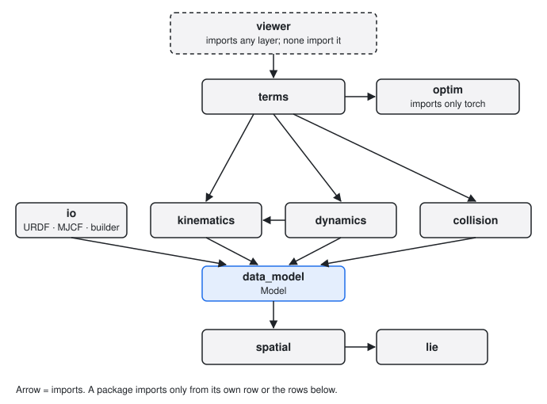

# Packages form a strict layering

After this page you know which package does what, which imports are allowed between them, what counts as
public API, and where inputs are validated. Read it before you add a module or move a function.

## Each package sits on one rank



`better_robot` is split into subpackages with numeric ranks. A module may import from its own rank or any
lower rank, never from a higher one. The ranks live in `tests/contract/test_layer_dependencies.py`, which
parses every source file and fails on an upward import.

| Rank | Package | Job |
|------|---------|-----|
| 7 | `viewer` | interactive 3-D display; nothing imports it |
| 6 | `terms` | robot cost terms (poses, limits, collision) and `solve_ik` |
| 5 | `io`, `kinematics`, `dynamics`, `collision` | parsing and model building; FK and Jacobians; RNEA, CRBA, centroidal; geometry and distances |
| 4 | `data_model` | `Model`, `ModelStructure`, `ModelValues`, joint models, bodies, frames |
| 3 | `spatial`, `optim` | 6-D motion, force and inertia algebra; robot-agnostic least squares |
| 2 | `lie` | SO(3) and SE(3) formulas on plain tensors |
| 1 | `_typing` | shared type aliases |

Packages on the same rank may import each other, so `dynamics` reuses the raw forward-kinematics helpers
from `kinematics`. `optim` imports only `torch`: it knows nothing about robots, and `terms` adapts robots to
it. Imports guarded by `TYPE_CHECKING` are exempt because they never run.

```text
viewer
  -> terms
       -> io   kinematics   dynamics   collision
            -> data_model -> spatial -> lie
       -> optim (torch only)
```

## Why the layering is strict

- The computational core (`lie` to `dynamics`) never loads optional dependencies such as `viser` or a
  URDF parser, so `import better_robot` stays light.
- A lower layer can change its internals without breaking a higher one, because the higher one sees only
  the lower one's public names.
- Tests for one layer need only the layers below it.

## Public API is what `__all__` lists

The root namespace is deliberately small. `better_robot.__all__` holds the core you use in most
scripts: `Model`, `ModelStructure`, `ModelValues`, `Joint`, `Body`, `Frame`, `load`, `ModelBuilder`,
`forward_kinematics_state`, `KinematicState`, `frame_jacobian`, `joint_jacobian`, their time variations,
`center_of_mass`, `inverse_dynamics`, `mass_matrix`, `forward_dynamics`, `centroidal_map`, `centroidal_momentum`
and `SE3`.
The subpackages `br.io`, `br.spatial` and `br.exceptions` are reachable as attributes of the root.
`tests/contract/test_public_api.py` checks that this core is present.

Everything else is public only under its qualified package name and only if that package's `__all__`
lists it, for example `better_robot.lie.so3`, `better_robot.kinematics.state` or `better_robot.optim.solve`.
Names that start with an underscore, and names missing from `__all__`, are implementation details and can
change without a deprecation.

The API reference documents each package's `__all__`:

| Package | Reference |
|---------|-----------|
| root | [better_robot](../reference/api/better_robot.md) |
| `lie`, `spatial` | [lie](../reference/api/lie.md), [spatial](../reference/api/spatial.md) |
| `data_model` | [data_model](../reference/api/data_model.md) |
| `io` | [io](../reference/api/io.md) |
| `kinematics`, `dynamics`, `collision` | [kinematics](../reference/api/kinematics.md), [dynamics](../reference/api/dynamics.md), [collision](../reference/api/collision.md) |
| `optim`, `terms` | [optim](../reference/api/optim.md), [terms](../reference/api/terms.md) |
| `viewer` | [viewer](../reference/api/viewer.md) |

```python
import better_robot as br
import better_robot.kinematics.state as kinematics_state

print(br.forward_kinematics_state is kinematics_state.forward_kinematics_state)   # True
print("ModelValues" in br.__all__)                                                 # True
```

## Inputs are validated once, at the boundary

!!! note "Contract"
    Public functions check the structure of their inputs: trailing shapes (`q (B..., nq)`,
    `v (B..., nv)`), dtype and device against the model's values. A violation raises a typed error from
    `better_robot.exceptions` (for example `DtypeMismatchError`) that names the argument. The raw tensor passes below them trust
    validated inputs and do no checks.

Three rules follow from this contract:

- No silent casts or moves. A `float32` model with a `float64` `q` is an error, not a conversion.
- Values are not scanned. Public functions do not test tensors for NaN or infinity; that would cost a
  device synchronisation on every call.
- Broadcasting follows PyTorch. Leading batch axes of `q`, `v` and the model's values broadcast together;
  trailing event axes must match exactly.

```python
import torch

model = br.ModelBuilder("one_joint")
model.add_body("base"); model.add_body("link")
model.add_revolute_z("j", parent="base", child="link")
model = br.io.build_model(model.finalize())

try:
    br.forward_kinematics_state(model, torch.zeros(5))          # wrong trailing size
except Exception as error:
    print(type(error).__name__)
```

## Where to go next

- [Model and state](model-and-state.md): the two objects every function takes.
- [Lie groups and spatial algebra](lie-and-spatial.md): the conventions the bottom two ranks fix.
- [Robot I/O](io.md): how a URDF or MJCF file becomes a `Model`.
