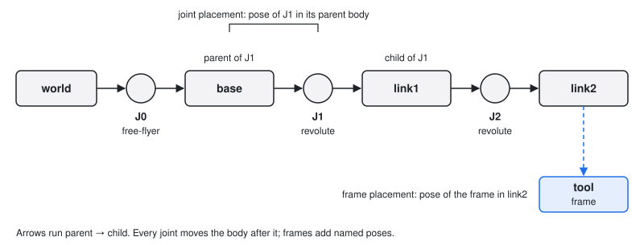

# Joints connect bodies; frames name poses on bodies

After this page you can read a model's kinematic tree, find where each joint's coordinates live in `q`
and `v`, step a configuration with `integrate` and `difference`, and look up a frame by name. You will
also know how a floating base enters the model: as a free-flyer `root_joint`.



## The tree is joints, bodies and frames

A model is a tree. Each **joint** connects a parent body to a child body. Its **joint placement**
`joint_placements[j] (7,)` is the pose of the joint in its parent joint's frame, written as
`[tx, ty, tz, qx, qy, qz, qw]` (see [Lie groups and spatial algebra](lie-and-spatial.md)). The joint
model then adds the motion that its coordinates produce. A **frame** is a named pose rigidly fixed to
a body; `frame_placements[f] (7,)` is its pose in the parent joint's frame.

The example builds the same two-joint arm as [Model and state](model-and-state.md).

```python
import torch
from better_robot import ModelBuilder
from better_robot.io import build_model

builder = ModelBuilder("arm", gravity=[0.0, 0.0, -9.81])
for body in ("base", "link1", "link2"):
    builder.add_body(body, mass=1.0)
builder.add_revolute("j1", axis=(0.0, 0.0, 1.0), parent="base", child="link1")
builder.add_revolute("j2", axis=(0.0, 1.0, 0.0), parent="link1", child="link2",
                       origin=torch.tensor([0.0, 0.0, 0.3, 0.0, 0.0, 0.0, 1.0]))
builder.add_frame("tool", parent="link2",
                  placement=torch.tensor([0.0, 0.0, 0.25, 0.0, 0.0, 0.0, 1.0]))
ir = builder.finalize()
model = build_model(ir)

print(model.joint_names)   # ('universe', 'root_joint', 'j1', 'j2')
print(model.parent_joint_ids)       # (-1, 0, 1, 2)
print([type(jm).__name__ for jm in model.joints])
# ['JointFixed', 'JointFixed', 'JointRevolute', 'JointRevolute']
```
```output
('universe', 'root_joint', 'j1', 'j2')
(-1, 0, 1, 2)
['JointFixed', 'JointFixed', 'JointRevolute', 'JointRevolute']
```

Joint 0 is always `universe`, the world, a `JointFixed`. Its parent is `-1`. Joint 1, `root_joint`, connects the world
to the root body; on a fixed-base model it is a `JointFixed` too. Joints are numbered so that a parent
always comes before its children.

## Every joint kind declares `nq`, `nv`, a manifold and an axis

A joint kind is a small frozen value in `better_robot.model` (a `JointModel`) that knows its sizes and how to turn
its coordinates into a placement. `nq` counts configuration coordinates; `nv` counts velocity coordinates. They
differ when the joint moves on a curved space, such as a rotation stored as a unit quaternion; the kind's
`manifold` says how `integrate` and `difference` step its coordinates. Revolute, prismatic and helical joints
carry their `axis` as data, a tuple of three floats in the joint frame.

| Joint kind | `nq` | `nv` | Manifold | `ModelBuilder` method |
|------------|------|------|----------|-----------------------|
| `JointRevolute(axis)` | 1 | 1 | Euclidean | `add_revolute(axis=)` |
| `JointRevoluteUnbounded(axis)` | 2 | 1 | circle `[cos θ, sin θ]` | `add_revolute(unbounded=True)` |
| `JointPrismatic(axis)` | 1 | 1 | Euclidean | `add_prismatic(axis=)` |
| `JointHelical(axis, pitch)` | 1 | 1 | Euclidean | `add_helical` |
| `JointSpherical()` | 4 | 3 | rotation (unit quaternion) | `add_spherical` |
| `JointPlanar()` | 4 | 3 | plane (SE(2)) | `add_planar` |
| `JointTranslation()` | 3 | 3 | Euclidean | |
| `JointFreeFlyer()` | 7 | 6 | rigid (SE(3)) | `add_free_flyer_root` |
| `JointFixed()` | 0 | 0 | | `add_fixed` |

## `idx_qs` and `idx_vs` say where a joint's coordinates live

`model.nq` and `model.nv` are the totals. `model.nqs[j]` and `model.nvs[j]` are the sizes of joint `j`,
and `model.idx_qs[j]` and `model.idx_vs[j]` are where its slice starts in `q (B..., nq)` and
`v (B..., nv)`. A joint with no coordinates reports size 0.

```python
print(model.nq, model.nv)              # 2 2
print(model.idx_qs, model.nqs)         # (0, 0, 0, 1) (0, 0, 1, 1)

j2 = model.joint_id("j2")
q = torch.tensor([0.1, 0.5])
print(q[..., model.idx_qs[j2] : model.idx_qs[j2] + model.nqs[j2]])   # tensor([0.5000])
```
```output
2 2
(0, 0, 0, 1) (0, 0, 1, 1)
tensor([0.5000])
```

## A floating base is a free-flyer `root_joint`

Pass `root_joint=JointFreeFlyer()` to `build_model` and the fixed root becomes a 6-DoF joint. Nothing
else changes: the same kinematics, Jacobian and dynamics functions take the longer `q`. The free-flyer
uses `nq = 7` (a pose, scalar-last quaternion) and `nv = 6` (a twist, linear first). A builder can also
declare it directly with `add_free_flyer_root`, and `better_robot.load` takes the same `root_joint`
argument (see [Loading robots](io.md)).

```python
from better_robot import JointFreeFlyer

floating = build_model(ir, root_joint=JointFreeFlyer())
print(floating.nq, floating.nv)        # 9 8
print(floating.idx_qs, floating.idx_vs)  # (0, 0, 7, 8) (0, 0, 6, 7)
print(floating.q_neutral)              # identity pose, then the arm joints at 0
```
```output
9 8
(0, 0, 7, 8) (0, 0, 6, 7)
tensor([0., 0., 0., 0., 0., 0., 1., 0., 0.])
```

## Step configurations with `integrate` and `difference`

Because `nq` and `nv` can differ, you never add a velocity to a configuration with `+`. Use
`kinematics.integrate(model, q, v)`, which moves each joint along its own manifold, and its inverse
`kinematics.difference(model, q0, q1)`, which returns the `v` that takes `q0` to `q1`. The free-flyer integrates
with the SE(3) exponential, so a forward speed combined with a yaw rate traces an arc, not a line.

```python
from better_robot.kinematics import difference, integrate

v = torch.zeros(floating.nv)
v[0], v[5] = 1.0, 0.5                  # move along local x while yawing
q1 = integrate(floating, floating.q_neutral, v)
print(q1[:3])                          # tensor([0.9589, 0.2448, 0.0000])
print(difference(floating, floating.q_neutral, q1))   # recovers v
assert torch.allclose(difference(floating, floating.q_neutral, q1), v, atol=1e-6)
```
```output
tensor([0.9589, 0.2448, 0.0000])
tensor([1.0000e+00, 1.4901e-08, 0.0000e+00, 0.0000e+00, 0.0000e+00, 5.0000e-01,
        0.0000e+00, 0.0000e+00])
```

`integrate` and `difference` broadcast over leading batch axes like every public function. Optimizers
use them through `terms.RobotManifold(model)` (see [Optimization](optimization.md)).

## Frames are looked up by name

Every body gets a frame of its own name; frames you add with `add_frame` keep theirs (a clash is a `ModelError`).
`model.frame_id(name)` returns the integer index that kinematics, Jacobians and collision spheres take.
`model.joint_id(name)` does the same for joints.

```python
print(model.frame_names)   # ('universe', 'base', 'link1', 'link2', 'tool')
tool = model.frame_id("tool")
print(tool)                # 4
```
```output
('universe', 'base', 'link1', 'link2', 'tool')
4
```

A frame's world pose comes from forward kinematics. The returned `KinematicState` holds every joint and
frame transform; `frame_pose_of(frame_id)` gives one pose `(B..., 7)`.

```python
from better_robot import forward_kinematics

state = forward_kinematics(model, torch.tensor([0.0, 0.5]))
print(state.frame_pose_of(tool))   # tensor([0.1199, 0.0000, 0.5194, 0.0000, 0.2474, 0.0000, 0.9689])
```
```output
tensor([0.1199, 0.0000, 0.5194, 0.0000, 0.2474, 0.0000, 0.9689])
```

The tool sits 0.25 m above `j2`, which sits 0.3 m above `j1`. Rotating `j2` by 0.5 rad about `y` tilts
the tool forward: $0.25 \sin 0.5 \approx 0.120$ in `x` and $0.3 + 0.25 \cos 0.5 \approx 0.519$ in `z`.

## Where next

- [Lie groups and spatial algebra](lie-and-spatial.md): the pose and twist conventions joints produce.
- [Kinematics and Jacobians](kinematics-and-jacobians.md): how joint motions compose into frame poses and Jacobians.
