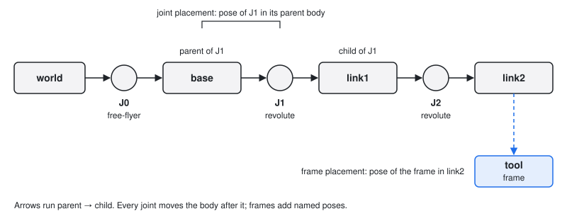

# Joints connect bodies; frames name poses on bodies

After this page you can read a model's kinematic tree, find where each joint's coordinates live in `q`
and `v`, step a configuration with `integrate` and `difference`, and look up a frame by name. You will
also know how a floating base enters the model: as a free-flyer `root_joint`.



## The tree is joints, bodies and frames

A model is a tree. Each **joint** connects a parent body to a child body. Its **joint placement**
`joint_placements[j] (7,)` is the pose of the joint in its parent joint's frame, written as
`[tx, ty, tz, qx, qy, qz, qw]` (see [Lie groups and spatial algebra](lie-and-spatial.md)). The joint
model then adds the motion that its coordinates produce. A **frame** is a named pose rigidly fixed to
a body; `frame_placements[f] (7,)` is its pose in the parent joint's frame.

The example builds the same two-joint arm as [Model and state](model-and-state.md).

```python
import torch
from better_robot.io import ModelBuilder, build_model

builder = ModelBuilder("arm", gravity=[0.0, 0.0, -9.81])
for body in ("base", "link1", "link2"):
    builder.add_body(body, mass=1.0)
builder.add_revolute_z("j1", parent="base", child="link1")
builder.add_revolute_y("j2", parent="link1", child="link2",
                       origin=torch.tensor([0.0, 0.0, 0.3, 0.0, 0.0, 0.0, 1.0]))
builder.add_frame("tool", parent_body="link2",
                  placement=torch.tensor([0.0, 0.0, 0.25, 0.0, 0.0, 0.0, 1.0]))
ir = builder.finalize()
model = build_model(ir)

print(model.joint_names)   # ('universe', 'root_joint', 'j1', 'j2')
print(model.parents)       # (-1, 0, 1, 2)
print([type(jm).__name__ for jm in model.joint_models])
# ['JointUniverse', 'JointFixed', 'JointRZ', 'JointRY']
```

Joint 0 is always `universe`, the world. Its parent is `-1`. Joint 1, `root_joint`, connects the world
to the root body; on a fixed-base model it is a `JointFixed`. Joints are numbered so that a parent
always comes before its children.

## Every joint model declares `nq` and `nv`

A joint model is a small object in `better_robot.data_model.joint_models` that knows its sizes and how
to turn its coordinates into a transform. `nq` counts configuration coordinates; `nv` counts velocity
coordinates. They differ when the joint moves on a curved space, such as a rotation stored as a unit
quaternion.

| Joint model | `nq` | `nv` | `ModelBuilder` method |
|-------------|------|------|-----------------------|
| `JointRX`, `JointRY`, `JointRZ`, `JointRevoluteUnaligned` | 1 | 1 | `add_revolute_x/_y/_z`, `add_revolute` |
| `JointRevoluteUnbounded` | 2 | 1 | |
| `JointPX`, `JointPY`, `JointPZ`, `JointPrismaticUnaligned` | 1 | 1 | `add_prismatic_x/_y/_z`, `add_prismatic` |
| `JointHelical` | 1 | 1 | `add_helical` |
| `JointSpherical` | 4 | 3 | `add_spherical` |
| `JointPlanar` | 4 | 3 | `add_planar` |
| `JointTranslation` | 3 | 3 | |
| `JointFreeFlyer` | 7 | 6 | `add_free_flyer_root` |
| `JointFixed`, `JointUniverse` | 0 | 0 | `add_fixed` |
| `JointComposite` | sum of its parts | sum of its parts | |

## `idx_qs` and `idx_vs` say where a joint's coordinates live

`model.nq` and `model.nv` are the totals. `model.nqs[j]` and `model.nvs[j]` are the sizes of joint `j`,
and `model.idx_qs[j]` and `model.idx_vs[j]` are where its slice starts in `q (B..., nq)` and
`v (B..., nv)`. A joint with no coordinates reports size 0.

```python
print(model.nq, model.nv)              # 2 2
print(model.idx_qs, model.nqs)         # (0, 0, 0, 1) (0, 0, 1, 1)

j2 = model.joint_id("j2")
q = torch.tensor([0.1, 0.5])
print(q[..., model.idx_qs[j2] : model.idx_qs[j2] + model.nqs[j2]])   # tensor([0.5000])
```

## A floating base is a free-flyer `root_joint`

Pass `root_joint=JointFreeFlyer()` to `build_model` and the fixed root becomes a 6-DoF joint. Nothing
else changes: the same kinematics, Jacobian and dynamics functions take the longer `q`. The free-flyer
uses `nq = 7` (a pose, scalar-last quaternion) and `nv = 6` (a twist, linear first). A builder can also
declare it directly with `add_free_flyer_root`, and `better_robot.load` takes the same `root_joint`
argument (or `free_flyer=True`) (see [Loading robots](io.md)).

```python
from better_robot.data_model.joint_models import JointFreeFlyer

floating = build_model(ir, root_joint=JointFreeFlyer())
print(floating.nq, floating.nv)        # 9 8
print(floating.idx_qs, floating.idx_vs)  # (0, 0, 7, 8) (0, 0, 6, 7)
print(floating.q_neutral)              # identity pose, then the arm joints at 0
```

## Step configurations with `integrate` and `difference`

Because `nq` and `nv` can differ, you never add a velocity to a configuration with `+`. Use
`model.integrate(q, v)`, which moves each joint along its own manifold, and its inverse
`model.difference(q0, q1)`, which returns the `v` that takes `q0` to `q1`. The free-flyer integrates
with the SE(3) exponential, so a forward speed combined with a yaw rate traces an arc, not a line.

```python
v = torch.zeros(floating.nv)
v[0], v[5] = 1.0, 0.5                  # move along local x while yawing
q1 = floating.integrate(floating.q_neutral, v)
print(q1[:3])                          # tensor([0.9589, 0.2448, 0.0000])
print(floating.difference(floating.q_neutral, q1))   # recovers v
assert torch.allclose(floating.difference(floating.q_neutral, q1), v, atol=1e-6)
```

`integrate` and `difference` broadcast over leading batch axes like every public function. Optimizers
use them through `terms.RobotManifold(model)` (see [Optimization](optimization.md)).

## Frames are looked up by name

Every body gets a frame named `body_<name>`; frames you add with `add_frame` keep their own name.
`model.frame_id(name)` returns the integer index that kinematics, Jacobians and collision spheres take.
`model.joint_id(name)` does the same for joints.

```python
print(model.frame_names)   # ('body_universe', 'body_base', 'body_link1', 'body_link2', 'tool')
tool = model.frame_id("tool")
print(tool)                # 4
```

A frame's world pose comes from forward kinematics. The returned `KinematicState` holds every joint and
frame transform; `frame_pose_of(frame_id)` gives one pose `(B..., 7)`.

```python
from better_robot.kinematics import forward_kinematics_state

state = forward_kinematics_state(model, torch.tensor([0.0, 0.5]))
print(state.frame_pose_of(tool))   # tensor([0.1199, 0.0000, 0.5194, 0.0000, 0.2474, 0.0000, 0.9689])
```

The tool sits 0.25 m above `j2`, which sits 0.3 m above `j1`. Rotating `j2` by 0.5 rad about `y` tilts
the tool forward: $0.25 \sin 0.5 \approx 0.120$ in `x` and $0.3 + 0.25 \cos 0.5 \approx 0.519$ in `z`.
[Kinematics and Jacobians](kinematics-and-jacobians.md) covers the rest of the state and the frame
Jacobians.
