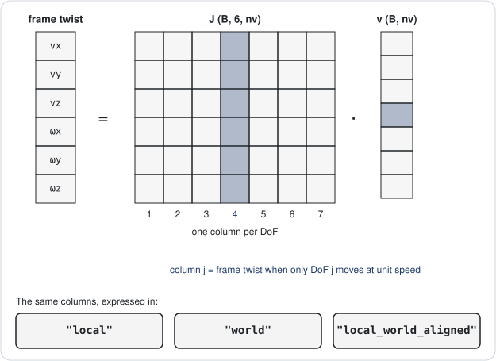

# One forward pass serves every pose and Jacobian query

After this page you can compute world poses of joints and frames for a batch of configurations, take
frame and joint Jacobians in the reference frame you need, and get their time derivative. Every function
here matches Pinocchio to the tolerances listed at the end.

## Forward kinematics fills a state

`forward_kinematics_state(model, q)` composes joint placements and joint motions from the root to the
leaves and returns a frozen [`KinematicState`](model-and-state.md#forward-kinematics-returns-a-kinematicstate).
`q` may have any number of leading batch axes: `q (B..., nq)` gives `joint_transform (B..., njoints, 3, 4)`.

```python
import torch
from better_robot.io import ModelBuilder, build_model
from better_robot.kinematics.state import (
    forward_kinematics_state, frame_jacobian, joint_jacobian, frame_jacobian_time_variation,
)

builder = ModelBuilder("arm")
for body in ("base", "link1", "link2"):
    builder.add_body(body, mass=1.0)
builder.add_revolute_z("j1", parent="base", child="link1")
builder.add_revolute_y("j2", parent="link1", child="link2",
                       origin=torch.tensor([0.0, 0.0, 0.3, 0.0, 0.0, 0.0, 1.0]))
builder.add_frame("tool", parent_body="link2",
                  placement=torch.tensor([0.0, 0.0, 0.25, 0.0, 0.0, 0.0, 1.0]))
model = build_model(builder.finalize())

q = torch.randn(16, 3, model.nq)            # any leading batch shape
state = forward_kinematics_state(model, q)
tool = model.frame_id("tool")
print(state.frame_pose_of(tool).shape)      # torch.Size([16, 3, 7])
```

Poses use the layout `[tx, ty, tz, qx, qy, qz, qw]` with the quaternion scalar last; see
[Lie groups and spatial algebra](lie-and-spatial.md).

## A Jacobian column is a twist



The frame Jacobian `J (B..., 6, nv)` maps a joint velocity `v (B..., nv)` to the frame's spatial velocity.
Rows are `[linear(3), angular(3)]`:

$$
\begin{bmatrix} \nu \\ \omega \end{bmatrix} = J(q)\, v .
$$

`frame_jacobian(model, state, frame, reference=...)` accepts a frame id or a frame name.
`joint_jacobian(model, state, joint, reference=...)` does the same for a joint's own frame.

```python
J = frame_jacobian(model, state, "tool")
print(J.shape)                               # torch.Size([16, 3, 6, 2])
J_joint = joint_jacobian(model, state, model.joint_id("j2"))
```

## The reference frame decides what a twist means

The same motion has three useful coordinate forms. `reference=` picks one:

| `reference=` | Linear rows | Angular rows | Typical use |
|--------------|-------------|--------------|-------------|
| `"local_world_aligned"` (default) | velocity of the frame origin, world axes | world axes | task-space IK, end-effector control |
| `"local"` | velocity of the frame origin, frame axes | frame axes | body-fixed sensors, tool-frame errors |
| `"world"` | velocity of the point at the world origin, world axes | world axes | spatial-algebra recursions |

`local_world_aligned` and `local` differ only by the frame rotation, so converting between them is a
rotation of each 3-row block, not a full adjoint. `world` differs from `local_world_aligned` in the
linear rows by $\omega \times p$, where $p$ is the frame origin.

```python
R = state.frame_rotation[..., tool, :, :]                    # (16, 3, 3, 3)
J_local = frame_jacobian(model, state, tool, reference="local")
J_lwa = frame_jacobian(model, state, tool)
print(torch.allclose(R @ J_local[..., :3, :], J_lwa[..., :3, :], atol=1e-5))   # True
```

## The time variation gives $\dot J$

`frame_jacobian_time_variation(model, state, v=v, frame=frame, reference=...)` and
`joint_jacobian_time_variation(model, state, v=v, joint=joint, reference=...)` return $\dot J (B..., 6, nv)$ at
velocity `v (B..., nv)`, in the same reference as the matching Jacobian. Use it for the drift term
$\dot J v$ in operational-space control and second-order task constraints.

```python
v = torch.randn(16, 3, model.nv)
dJ = frame_jacobian_time_variation(model, state, v=v, frame=tool)
print(dJ.shape)                              # torch.Size([16, 3, 6, 2])
```

## Batching and gradients

Every function above is batched by broadcasting: `q`, `v` and the model's values can each carry leading
axes, and they broadcast together ([Model and state](model-and-state.md#with_values-returns-a-changed-copy)).
All operations are differentiable PyTorch, so `torch.autograd` gives derivatives with respect to `q` or
to model values without extra code. Inputs are validated once in these public functions (shape, dtype,
device); the inner loops trust them.

## Parity with Pinocchio

The tests in `tests/test_pinocchio/` compare each function against Pinocchio's implementation.

| Quantity | Test file | Tolerance (`atol`) |
|----------|-----------|--------------------|
| Forward kinematics | `test_fk_matches_pinocchio.py` | `1e-12` (float64), `2e-6` (float32) |
| Frame Jacobian, all references | `test_frame_jacobian_matches_pinocchio.py` | `1e-10`, `2e-6` |
| Joint Jacobian | `test_joint_jacobian_matches_pinocchio.py` | `2e-6` |
| Jacobian time variation | `test_jacobian_time_variation_matches_pinocchio.py` | `2e-6` |

API details: [kinematics reference](../reference/api/kinematics.md).
