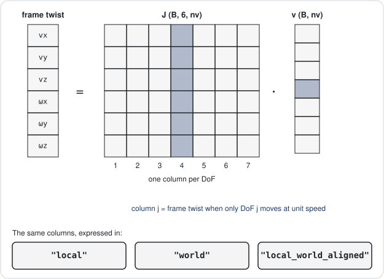

# One forward pass serves every pose and Jacobian query

After this page you can compute world poses of joints and frames for a batch of configurations, take
frame and joint Jacobians in the reference frame you need, and get their time derivative. Every function
here matches Pinocchio to the tolerances listed at the end.

## Forward kinematics fills a state

`forward_kinematics(model, q)` composes joint placements and joint motions from the root to the
leaves and returns a frozen [`KinematicState`](model-and-state.md#forward-kinematics-returns-a-kinematicstate).
`q` may have any number of leading batch axes: `q (B..., nq)` gives `joint_transforms (B..., njoints, 3, 4)`.

```python
import torch
from better_robot import ModelBuilder
from better_robot.io import build_model
from better_robot.kinematics import (
    forward_kinematics, frame_jacobian, joint_jacobian, frame_jacobian_time_variation,
)

builder = ModelBuilder("arm")
for body in ("base", "link1", "link2"):
    builder.add_body(body, mass=1.0)
builder.add_revolute("j1", axis=(0.0, 0.0, 1.0), parent="base", child="link1")
builder.add_revolute("j2", axis=(0.0, 1.0, 0.0), parent="link1", child="link2",
                       origin=torch.tensor([0.0, 0.0, 0.3, 0.0, 0.0, 0.0, 1.0]))
builder.add_frame("tool", parent="link2",
                  placement=torch.tensor([0.0, 0.0, 0.25, 0.0, 0.0, 0.0, 1.0]))
model = build_model(builder.finalize())

q = torch.randn(16, 3, model.nq)            # any leading batch shape
state = forward_kinematics(model, q)
tool = model.frame_id("tool")
print(state.frame_pose_of(tool).shape)      # torch.Size([16, 3, 7])
```
```output
torch.Size([16, 3, 7])
```

Poses use the layout `[tx, ty, tz, qx, qy, qz, qw]` with the quaternion scalar last; see
[Lie groups and spatial algebra](lie-and-spatial.md).

## A Jacobian column is a twist



The frame Jacobian `J (B..., 6, nv)` maps a joint velocity `v (B..., nv)` to the frame's spatial velocity.
Rows are `[linear(3), angular(3)]`:

$$
\begin{bmatrix} \nu \\ \omega \end{bmatrix} = J(q)\, v .
$$

`frame_jacobian(model, state, *, frame, reference=...)` accepts a frame id or a frame name.
`joint_jacobian(model, state, *, joint, reference=...)` does the same for a joint's own frame, with a joint id or a joint name.

```python
J = frame_jacobian(model, state, frame="tool")
print(J.shape)                               # torch.Size([16, 3, 6, 2])
J_joint = joint_jacobian(model, state, joint=model.joint_id("j2"))
```
```output
torch.Size([16, 3, 6, 2])
```

## The reference frame decides what a twist means

The same motion has three useful coordinate forms. `reference=` picks one:

| `reference=` | Linear rows | Angular rows | Typical use |
|--------------|-------------|--------------|-------------|
| `"local_world_aligned"` (default) | velocity of the frame origin, world axes | world axes | task-space IK, end-effector control |
| `"local"` | velocity of the frame origin, frame axes | frame axes | body-fixed sensors, tool-frame errors |
| `"world"` | velocity of the point at the world origin, world axes | world axes | spatial-algebra recursions |

`local_world_aligned` and `local` differ only by the frame rotation, so converting between them is a
rotation of each 3-row block, not a full adjoint. `world` differs from `local_world_aligned` in the
linear rows by $\omega \times p$, where $p$ is the frame origin.

```python
R = state.frame_rotations[..., tool, :, :]                    # (16, 3, 3, 3)
J_local = frame_jacobian(model, state, frame=tool, reference="local")
J_lwa = frame_jacobian(model, state, frame=tool)
print(torch.allclose(R @ J_local[..., :3, :], J_lwa[..., :3, :], atol=1e-5))   # True
```
```output
True
```

## A point fixed to a body has a 3-row Jacobian

`point_jacobian(model, state, *, frames, points)` gives the world velocity of points fixed to frames,
`(B..., K, 3, nv)`: point `k` sits at `points[..., k, :]` in the coordinates of `frames[k]`, with `points`
`(K, 3)` or `(B..., K, 3)`. Its rows are the `local_world_aligned` linear rows moved to each point.
`J.mT @ f` maps world forces `f: (B..., K, 3, 1)` at contact points to one generalized force per point;
`(J.mT @ f).sum(-3)` is the generalized force of them all.

```python
from better_robot.kinematics import point_jacobian

offsets = torch.tensor([[0.0, 0.0, 0.0], [0.0, 0.1, 0.0]])
J_points = point_jacobian(model, state, frames=["tool", "tool"], points=offsets)
print(J_points.shape)                        # torch.Size([16, 3, 2, 3, 2])
print(torch.allclose(J_points[..., 0, :, :], J_lwa[..., :3, :], atol=1e-5))   # True
```
```output
torch.Size([16, 3, 2, 3, 2])
True
```

## The time variation gives $\dot J$

`frame_jacobian_time_variation(model, state, v=v, frame=frame, reference=...)` and
`joint_jacobian_time_variation(model, state, v=v, joint=joint, reference=...)` return $\dot J (B..., 6, nv)$ at
velocity `v (B..., nv)`, in the same reference as the matching Jacobian. Use it for the drift term
$\dot J v$ in operational-space control and second-order task constraints.

```python
v = torch.randn(16, 3, model.nv)
dJ = frame_jacobian_time_variation(model, state, v=v, frame=tool)
print(dJ.shape)                              # torch.Size([16, 3, 6, 2])
```
```output
torch.Size([16, 3, 6, 2])
```

$\dot J$ is the plain time derivative of the Jacobian in the same reference, $\frac{d}{dt} J(q(t))$ with
$\dot q = v$, in all three references; Pinocchio 3.9 agrees in each. It is transport only: in the `world` reference
the columns of joint $i$ are $\mathrm{ad}(v_i)\, J_i$, where $v_i = [\nu_i; \omega_i]$ is the world spatial velocity
of joint $i$ and $\mathrm{ad}(v_i) = \begin{bmatrix} \hat\omega_i & \hat\nu_i \\ 0 & \hat\omega_i \end{bmatrix}$. No
$\dot S$ term appears, because every joint's motion subspace is constant in the joint's own frame. The other two
references follow from the `world` one, with $p$ the reference origin, $v = [\nu; \omega]$ its world spatial
velocity, $v_p = \nu + \omega \times p$ the world velocity of the point $p$, $M$ the reference pose, $v_{local}$
its local spatial velocity, and $J^W$, $\dot J^W$ (`JW`, `dJW`) the `world` Jacobian and its time variation:

```text
local_world_aligned:  dJ_ang = dJW_ang
                      dJ_lin = dJW_lin - p x dJW_ang - v_p x JW_ang
local:                dJ     = Ad(M)^-1 dJW - ad(v_local) (Ad(M)^-1 JW)
```

Translating $\dot J^W$ the way the static Jacobian is translated misses the $- v_p \times J^W_\omega$ term and is off by
order one. The acceleration identity $a = J \dot v + \dot J v$ holds with the spatial acceleration in `world` and
`local`, and with the classical acceleration of the frame origin in `local_world_aligned`.

## Batching and gradients

Every function above is batched by broadcasting: `q`, `v` and the model's values can each carry leading
axes, and they broadcast together ([Model and state](model-and-state.md#with_values-returns-a-changed-copy)).
All operations are differentiable PyTorch, so `torch.autograd` gives derivatives with respect to `q` or
to model values without extra code; $\partial J / \partial q$ comes this way too, and a kinematic-Hessian function
like Pinocchio's is a non-goal. Inputs are validated once in these public functions (shape, dtype,
device); the inner loops trust them.

## Parity with Pinocchio

The tests in `tests/parity/pinocchio/` compare each function against Pinocchio's implementation.

| Quantity | Test file | Tolerance (`atol`) |
|----------|-----------|--------------------|
| Forward kinematics | `test_fk_matches_pinocchio.py` | `1e-12` (float64), `2e-6` (float32) |
| Frame Jacobian, all references | `test_frame_jacobian_matches_pinocchio.py` | `1e-10`, `2e-6` |
| Joint Jacobian | `test_joint_jacobian_matches_pinocchio.py` | `2e-6` |
| Jacobian time variation | `test_jacobian_time_variation_matches_pinocchio.py` | `2e-6` |

API details: [kinematics reference](../reference/api/kinematics.md).

## Where next

- [Dynamics](dynamics.md): forces and accelerations on the same `KinematicState`.
- [Optimization](optimization.md): Jacobians feed the Gauss-Newton step.
