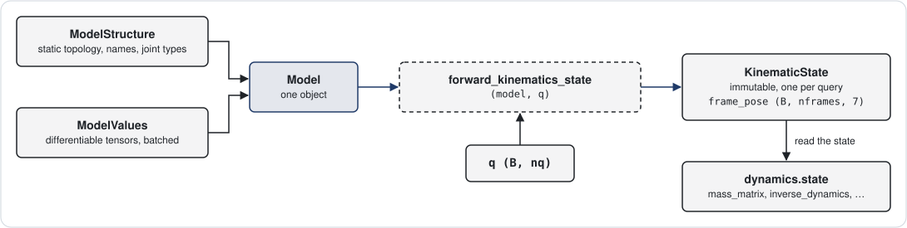

# A model is fixed; each query returns a new state

After this page you can build a `Model`, swap its differentiable values with `with_values`, and read
every field of the `KinematicState` that forward kinematics returns. You will also know which objects
you may change (none) and how to get a changed copy instead.



## A model is structure plus values

`Model` is a frozen dataclass with four stored fields:

| Field | Holds | Changes when |
|-------|-------|--------------|
| `structure` | `ModelStructure`: topology, names, joint models, index tables (`nq`, `nv`, `idx_qs`, `parents`, ...) | never |
| `values` | `ModelValues`: tensors (placements, inertias, limits, gravity, `q_neutral`, ...) | you call `with_values` or `to` |
| `reference_configurations` | named `q` tensors such as a home pose | never |
| `meta` | loader metadata | never |

`ModelStructure` is plain Python data: integers, tuples and index tensors. Nothing in it carries a
gradient. `ModelValues` holds every tensor you might want to differentiate or batch, for example
`joint_placements (njoints, 7)`, `body_inertias (nbodies, 10)`, `frame_placements`, the limit
vectors and `gravity (6,)`. `Model` re-exports both sides as flat properties, so `model.nq` and
`model.joint_placements` work without reaching into the parts.

The example below builds a two-joint arm with the dependency-free [`ModelBuilder`](io.md).

```python
import torch
from better_robot.io import ModelBuilder, build_model

builder = ModelBuilder("arm", gravity=[0.0, 0.0, -9.81])
for body in ("base", "link1", "link2"):
    builder.add_body(body, mass=1.0)
builder.add_revolute_z("j1", parent="base", child="link1")
builder.add_revolute_y("j2", parent="link1", child="link2",
                       origin=torch.tensor([0.0, 0.0, 0.3, 0.0, 0.0, 0.0, 1.0]))
builder.add_frame("tool", parent_body="link2",
                  placement=torch.tensor([0.0, 0.0, 0.25, 0.0, 0.0, 0.0, 1.0]))
model = build_model(builder.finalize())

print(model.nq, model.nv, model.joint_names)   # 2 2 ('universe', 'root_joint', 'j1', 'j2')
print(type(model.structure).__name__, type(model.values).__name__)
```
```output
2 2 ('universe', 'root_joint', 'j1', 'j2')
ModelStructure ModelValues
```

Joint 0 is always `universe`. A fixed-base model gets a fixed `root_joint`; a floating-base model gets
a free-flyer there instead (see [Joints, bodies and frames](joints-bodies-frames.md)).

## You never mutate a model

`Model`, `ModelStructure` and `ModelValues` are frozen dataclasses. Assigning a field raises
`FrozenInstanceError`. Treat the contained tensors and dictionaries as read-only too: the dataclass
freeze is shallow, and an in-place write would change every model and state that shares the tensor.

```python
import dataclasses

try:
    model.values = model.values
except dataclasses.FrozenInstanceError:
    print("models are frozen")
```
```output
models are frozen
```

## `with_values` returns a changed copy

`with_values(joint_placements=..., body_inertias=..., frame_placements=..., armature=...)` pairs the same
structure with new tensors. It checks each tensor's trailing shape, dtype and device against the current values
and normalizes the quaternion part of placements. Any argument you leave out keeps its current tensor.
`armature (nv,)`, the motor inertia that [dynamics](dynamics.md) adds per coordinate, takes no batch axes.

Values may carry leading batch axes. A batch of 8 models with different link lengths is one `Model`:

```python
placements = model.joint_placements.expand(8, -1, -1).clone()   # (8, njoints, 7)
placements[:, 3, 2] = torch.linspace(0.2, 0.4, 8)               # z offset of joint j2
batched = model.with_values(joint_placements=placements)
print(batched.joint_placements.shape)                            # torch.Size([8, 4, 7])
```
```output
torch.Size([8, 4, 7])
```

Gradients flow through `with_values`: pass a tensor with `requires_grad=True` and differentiate any
downstream quantity with respect to it. `model.to(device=..., dtype=...)` moves all values at once.

!!! note "Contract"
    Batched values broadcast against the batch of `q` by the usual PyTorch rules. A model batch of 8
    and a `q (8, nq)` pair element-wise.

## Forward kinematics returns a `KinematicState`

`forward_kinematics_state(model, q)` takes `q (B..., nq)` and returns a frozen `KinematicState`. It stores
three tensors; everything else is derived on demand and memoized.

| Member | Shape | Meaning |
|--------|-------|---------|
| `q` | `(B..., nq)` | the configuration the state was computed at |
| `joint_transform` | `(B..., njoints, 3, 4)` | world `[R | p]` of every joint |
| `frame_transform` | `(B..., nframes, 3, 4)` | world `[R | p]` of every frame |
| `joint_translation`, `joint_rotation` | `(B..., njoints, 3)`, `(..., 3, 3)` | slices of `joint_transform` |
| `frame_translation`, `frame_rotation` | `(B..., nframes, 3)`, `(..., 3, 3)` | slices of `frame_transform` |
| `joint_pose`, `frame_pose` | `(B..., n, 7)` | the same placements as `[tx, ty, tz, qx, qy, qz, qw]` |
| `frame_pose_of(frame)` | `(B..., 7)` | one frame's pose, by id or name |

```python
from better_robot.kinematics.state import forward_kinematics_state

q = torch.zeros(4, model.nq)
state = forward_kinematics_state(model, q)
print(state.joint_transform.shape)                       # torch.Size([4, 4, 3, 4])
print(state.frame_pose_of(model.frame_id("tool")))       # (4, 7)
print(state.frame_pose_of("tool"))                       # same: a state knows its model's names
```
```output
torch.Size([4, 4, 3, 4])
tensor([[0.0000, 0.0000, 0.5500, 0.0000, 0.0000, 0.0000, 1.0000],
        [0.0000, 0.0000, 0.5500, 0.0000, 0.0000, 0.0000, 1.0000],
        [0.0000, 0.0000, 0.5500, 0.0000, 0.0000, 0.0000, 1.0000],
        [0.0000, 0.0000, 0.5500, 0.0000, 0.0000, 0.0000, 1.0000]])
tensor([[0.0000, 0.0000, 0.5500, 0.0000, 0.0000, 0.0000, 1.0000],
...
```

A state belongs to one configuration. To evaluate a new `q`, call `forward_kinematics_state` again; there is
no update-in-place. Jacobians ([Kinematics and Jacobians](kinematics-and-jacobians.md)) and dynamics
([Dynamics](dynamics.md)) take `(model, state, ...)` and read what they need from the state, so one
forward pass serves several queries.

## Configuration arithmetic goes through the model

`nq` and `nv` differ as soon as a model has a free-flyer or spherical joint: a quaternion has four
coordinates but three velocity directions. Use `model.integrate(q, v)` to step a configuration and
`model.difference(q0, q1)` to get the tangent between two, never `q + v` or `q1 - q0`.

```python
v = torch.full((4, model.nv), 0.1)
q_next = model.integrate(q, v)
print(torch.allclose(model.difference(q, q_next), v))    # True
```
```output
True
```

Other helpers on `Model`: `random_configuration()`, `q_neutral`, `frame_id(name)`, `joint_id(name)`,
`body_id(name)`, `get_subtree(joint_id)`, `get_support(joint_id)`. The full list is in the
[data_model API reference](../reference/api/data_model.md).

## Where next

- [Joints, bodies and frames](joints-bodies-frames.md): what the structure inside a `Model` is made of.
- [Kinematics and Jacobians](kinematics-and-jacobians.md): what you can read from a `KinematicState`.
