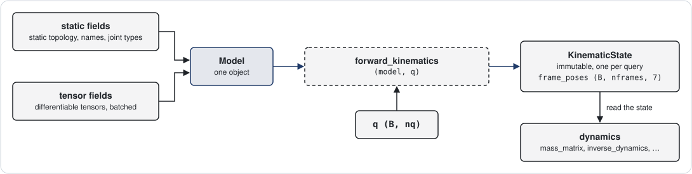

# A model is fixed; each query returns a new state

After this page you can build a `Model`, swap its differentiable values with `with_values`, and read
every field of the `KinematicState` that forward kinematics returns. You will also know which objects
you may change (none) and how to get a changed copy instead.



## A model is one flat record

`Model` is a frozen dataclass with two kinds of fields:

| Kind | Fields | Changes when |
|------|--------|--------------|
| static | `name`, `joint_names`, `body_names`, `frame_names`, `joints`, `parents`, the index tables (`nqs`, `nvs`, `idx_qs`, `idx_vs`, ...), the mimic chain | never |
| tensor | `joint_placements (njoints, 7)`, `body_inertias (nbodies, 10)`, `frame_placements (nframes, 7)`, the limit vectors, `armature`, `damping`, `gravity (6,)`, `q_neutral (nq,)` | you call `with_values` or `to` |

The static fields are plain Python data: strings, tuples and joint objects. Nothing in them carries a
gradient. The tensor fields hold everything you might want to differentiate or batch. Counts such as
`model.nq`, `model.nv` and `model.njoints` are derived from the static fields, and `model.dtype` and
`model.device` are those of the tensor fields.

The example below builds a two-joint arm with the dependency-free [`ModelBuilder`](io.md).

```python
import torch
from better_robot.io import ModelBuilder, build_model

builder = ModelBuilder("arm", gravity=[0.0, 0.0, -9.81])
for body in ("base", "link1", "link2"):
    builder.add_body(body, mass=1.0)
builder.add_revolute_z("j1", parent="base", child="link1")
builder.add_revolute_y("j2", parent="link1", child="link2",
                       origin=torch.tensor([0.0, 0.0, 0.3, 0.0, 0.0, 0.0, 1.0]))
builder.add_frame("tool", parent_body="link2",
                  placement=torch.tensor([0.0, 0.0, 0.25, 0.0, 0.0, 0.0, 1.0]))
model = build_model(builder.finalize())

print(model.nq, model.nv, model.joint_names)   # 2 2 ('universe', 'root_joint', 'j1', 'j2')
print(model.njoints, tuple(model.joint_placements.shape))
```
```output
2 2 ('universe', 'root_joint', 'j1', 'j2')
4 (4, 7)
```

Joint 0 is always `universe`. A fixed-base model gets a fixed `root_joint`; a floating-base model gets
a free-flyer there instead (see [Joints, bodies and frames](joints-bodies-frames.md)).

## You never mutate a model

`Model` is a frozen dataclass. Assigning a field raises `FrozenInstanceError`. Treat the contained
tensors and dictionaries as read-only too: the dataclass freeze is shallow, and an in-place write would
change every model and state that shares the tensor.

```python
import dataclasses

try:
    model.joint_placements = model.joint_placements
except dataclasses.FrozenInstanceError:
    print("models are frozen")
```
```output
models are frozen
```

## `with_values` returns a changed copy

`with_values(joint_placements=..., body_inertias=..., frame_placements=..., armature=...)` replaces the tensor
fields you pass and keeps every other field. It checks each tensor's trailing shape, dtype and device against the
model's and normalizes the quaternion part of placements. Any argument you leave out keeps its current tensor.
`armature (nv,)`, the motor inertia that [dynamics](dynamics.md) adds per coordinate, takes no batch axes.

Values may carry leading batch axes. A batch of 8 models with different link lengths is one `Model`:

```python
placements = model.joint_placements.expand(8, -1, -1).clone()   # (8, njoints, 7)
placements[:, 3, 2] = torch.linspace(0.2, 0.4, 8)               # z offset of joint j2
batched = model.with_values(joint_placements=placements)
print(batched.joint_placements.shape)                            # torch.Size([8, 4, 7])
```
```output
torch.Size([8, 4, 7])
```

Gradients flow through `with_values`: pass a tensor with `requires_grad=True` and differentiate any
downstream quantity with respect to it. `model.to(device=..., dtype=...)` moves all values at once.

!!! note "Contract"
    Batched values broadcast against the batch of `q` by the usual PyTorch rules. A model batch of 8
    and a `q (8, nq)` pair element-wise.

## Forward kinematics returns a `KinematicState`

`forward_kinematics(model, q)` takes `q (B..., nq)` and returns a frozen `KinematicState`. It stores
three tensors; everything else is derived on demand and memoized.

| Member | Shape | Meaning |
|--------|-------|---------|
| `q` | `(B..., nq)` | the configuration the state was computed at |
| `joint_transforms` | `(B..., njoints, 3, 4)` | world `[R | p]` of every joint |
| `frame_transforms` | `(B..., nframes, 3, 4)` | world `[R | p]` of every frame |
| `joint_translations`, `joint_rotations` | `(B..., njoints, 3)`, `(..., 3, 3)` | slices of `joint_transforms` |
| `frame_translations`, `frame_rotations` | `(B..., nframes, 3)`, `(..., 3, 3)` | slices of `frame_transforms` |
| `joint_poses`, `frame_poses` | `(B..., n, 7)` | the same placements as `[tx, ty, tz, qx, qy, qz, qw]` |
| `frame_pose_of(frame)` | `(B..., 7)` | one frame's pose, by id or name |

```python
from better_robot.kinematics import forward_kinematics

q = torch.zeros(4, model.nq)
state = forward_kinematics(model, q)
print(state.joint_transforms.shape)                       # torch.Size([4, 4, 3, 4])
print(state.frame_pose_of(model.frame_id("tool")))       # (4, 7)
print(state.frame_pose_of("tool"))                       # same: a state knows its model's names
```
```output
torch.Size([4, 4, 3, 4])
tensor([[0.0000, 0.0000, 0.5500, 0.0000, 0.0000, 0.0000, 1.0000],
        [0.0000, 0.0000, 0.5500, 0.0000, 0.0000, 0.0000, 1.0000],
        [0.0000, 0.0000, 0.5500, 0.0000, 0.0000, 0.0000, 1.0000],
        [0.0000, 0.0000, 0.5500, 0.0000, 0.0000, 0.0000, 1.0000]])
tensor([[0.0000, 0.0000, 0.5500, 0.0000, 0.0000, 0.0000, 1.0000],
...
```

A state belongs to one configuration. To evaluate a new `q`, call `forward_kinematics` again; there is
no update-in-place. Jacobians ([Kinematics and Jacobians](kinematics-and-jacobians.md)) and dynamics
([Dynamics](dynamics.md)) take `(model, state, ...)` and read what they need from the state, so one
forward pass serves several queries.

## Configuration arithmetic goes through the manifold

`nq` and `nv` differ as soon as a model has a free-flyer or spherical joint: a quaternion has four
coordinates but three velocity directions. Use `kinematics.integrate(model, q, v)` to step a configuration
and `kinematics.difference(model, q0, q1)` to get the tangent between two, never `q + v` or `q1 - q0`.

```python
from better_robot.kinematics import difference, integrate

v = torch.full((4, model.nv), 0.1)
q_next = integrate(model, q, v)
print(torch.allclose(difference(model, q, q_next), v))    # True
```
```output
True
```

Other helpers on `Model`: `random_configuration(generator=...)`, `q_neutral`, `frame_id(name)`,
`joint_id(name)`, `body_id(name)`; tree queries are `kinematics.subtree(model, joint=...)` and
`kinematics.support(model, joint=...)`. The full list is in the [model API reference](../reference/api/model.md).

## Where next

- [Joints, bodies and frames](joints-bodies-frames.md): what the structure inside a `Model` is made of.
- [Kinematics and Jacobians](kinematics-and-jacobians.md): what you can read from a `KinematicState`.
