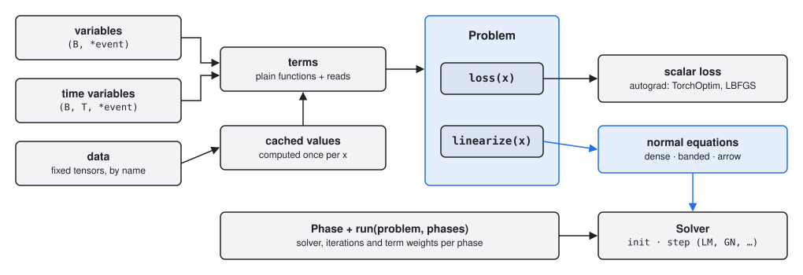

# Optimization

`better_robot.optim` minimizes a sum of terms over named tensors. After this page you can build a
`Problem`, write terms as plain functions, pick a solver, and check an analytic Jacobian.
The package imports only torch; robot terms live in `better_robot.terms`.

## A problem is variables, data and terms

A **variable** is a named tensor `(B, *event)` that the solver changes. All variables share the batch
size `B`, and the `B` problems of a batch are independent: each has its own loss, step and convergence
flag. **Data** are tensors the terms read but the solver never changes (targets, network outputs).
A **term** is a plain function. Its parameter names say what it reads: a variable, a data tensor or a
cached value.

```python
import torch
from better_robot.optim import LevenbergMarquardt, Problem, solve

torch.manual_seed(0)
problem = Problem({"x": torch.zeros(4, 2)}, data={"target": torch.randn(4, 2)})
problem.residual("fit", lambda x, target: x - target)
result = solve(problem, LevenbergMarquardt(), iters=20)
assert result.x["x"].shape == (4, 2) and bool(result.done.all())
```



`Problem(variables, manifolds=, bounds=, data=, time=, dense=)` takes the rest as keywords:

| Argument | Meaning |
|---|---|
| `manifolds` | per-variable `Manifold` (`retract`, `project`); missing entries are `Euclidean` |
| `bounds` | per-variable `(lower, upper)`, enforced by clamping after every step |
| `data` | tensors the terms read; a `Phase` may refresh them |
| `time` | names of variables shaped `(B, T, *event)`, see [Time and structure](time-and-structure.md) |
| `dense` | force dense normal equations even when the banded form applies |

## Terms are functions

`residual(name, fn, weight=, kernel=, jac=, reads=, window=)` adds a least-squares term. `fn` returns
`(B, ..., k)` and its loss is `½ · weight · Σ r²`. `scalar(name, fn, weight=)` adds a term that already
returns a `(B,)` loss. `cached(fn, name=)` registers an intermediate that several terms read, such as a
kinematic state; it is computed at most once per evaluation.

```python
problem = Problem({"x": torch.zeros(4, 2)}, data={"target": torch.randn(4, 2)})

@problem.cached
def doubled(x):
    return 2.0 * x

problem.residual("fit", lambda doubled, target: doubled - target)
problem.scalar("small", lambda x: (x**2).sum(-1), weight=1e-2)
print({name: tuple(value.shape) for name, value in problem.losses().items()})  # each (4,)
```

`reads=` overrides the parameter names when the function takes `*args` or its names clash.
A term never touches the solver: it maps tensors to tensors, so the same function serves autograd,
Gauss-Newton and your own loop.

### Analytic Jacobians and `TermFn`

Without `jac`, the Jacobian comes from autodiff. A `TermFn(fn, reads, jac=, window=)` bundles a function
with what it reads and, optionally, an analytic Jacobian. `jac(*reads)` returns `{variable: (B, m, n)}`,
one block per variable in that variable's tangent coordinates, with the chain rule through any cached
value already applied. `window=k` declares a time-local term; see
[Time and structure](time-and-structure.md#windows-make-terms-time-local).

```python
from better_robot.optim import TermFn, check_jacobian

def fit_jac(x, target):
    return {"x": torch.eye(2).expand(x.shape[0], 2, 2)}

problem = Problem({"x": torch.zeros(4, 2)}, data={"target": torch.randn(4, 2)})
problem.residual("fit", TermFn(lambda x, target: x - target, reads=("x", "target"), jac=fit_jac))
errors = check_jacobian(problem)
assert errors["fit"] < 1e-6
```

`check_jacobian(problem, x=None)` compares every term that has a `jac` or a `window` with plain
row-by-row autodiff and returns `{term: error}`, measured on `H` and `g` relative to the largest entry of
`H`. Run it in a test for every term you write; [Write a term](../guides/write-a-term.md) walks through one.

### Robust kernels

`kernel=` makes the last axis of the residual one robust group: the loss becomes
`Σ kernel.rho(weight · ‖r‖²)`. `Huber(delta=)`, `Cauchy`, `GemanMcClure` and `Tukey` down-weight outliers.

```python
from better_robot.optim import Huber

problem = Problem({"x": torch.zeros(4, 2)}, data={"target": torch.randn(4, 2)})
problem.residual("fit", lambda x, target: x - target, kernel=Huber(delta=0.1))
```

## `loss` feeds autograd, `linearize` feeds Gauss-Newton

The same terms give two views of the problem.

- `problem.loss(x)` is an ordinary differentiable `(B,)` tensor. Any `torch.optim` optimizer can minimize
  it, and you can put it inside your own training loop ([Own the loop](../guides/own-the-loop.md)).
- `problem.linearize(x)` returns `(normal, loss)`: the Gauss-Newton normal equations $J^\top W J\,\delta =
  -J^\top W r$ and the `(B,)` loss. `normal` is a `Normal` (dense), a `BandedNormal` or an `ArrowNormal`;
  all three expose `solve`, `masked`, `restrict` and `predicted_decrease`, so solvers do not care which.

```python
normal, loss = problem.linearize(problem.variables)
print(type(normal).__name__, tuple(loss.shape))  # Normal (4,)
```

A `scalar` term contributes its gradient to `linearize` but not its curvature, so Gauss-Newton and LM
treat it as a first-order term.

## Solvers are `init` and `step`

A solver implements the `Solver` protocol: `init(problem, x) -> State` and
`step(problem, state) -> State`. `State` holds `x`, the `(B,)` `loss`, the `(B,)` bool `done`, the step
count `it`, and `extra` for solver-owned values (damping, moments).

| Solver | Uses | Notes |
|---|---|---|
| `LevenbergMarquardt(damping=, gtol=, ftol=, xtol=)` | `linearize` | per-problem damping, Marquardt scaling; the default choice |
| `GaussNewton(damping=0.0)` | `linearize` | full step, optional fixed damping; fast near a good start |
| `LBFGS(history=10, line_search=8)` | `loss` gradient | tangent coordinates, per-problem history and Armijo backtracking |
| `TorchOptim(torch.optim.Adam, lr=...)` | `loss` | any `torch.optim` optimizer; projects onto manifolds and bounds after each step |

Because a solver is two functions, you can drive it yourself:

```python
solver = LevenbergMarquardt()
state = solver.init(problem, dict(problem.variables))
while not bool(state.done.all()) and state.it < 50:
    state = solver.step(problem, state)
print(state.it, state.loss)
```

## `solve`, `run` and friends

- `solve(problem, solver, iters=50, x=None) -> Result` runs one solver until every problem is done or
  `iters` steps pass. `Result` has `x`, `loss`, `done`, `iters` and a per-phase loss `history`.
- `run(problem, phases)` chains `Phase`s, each with its own solver, weight overrides and frozen
  coordinates ([Fit a clip](../guides/fit-a-clip.md)).
- `solve_layer(problem, solver)` returns the solution attached to the autograd graph of the data
  ([Own the loop](../guides/own-the-loop.md)).
- `solve_constrained(problem, solver, equalities=, inequalities=)` turns named terms into hard
  constraints with an augmented Lagrangian ([Hard constraints](../guides/hard-constraints.md)).

`problem.with_(weights=, free=)` returns a view with term weights overridden (`0` switches a term off) and
tangent coordinates frozen by a bool mask `(n,)` or `(B, n)`. `Phase` uses it internally.

```python
from better_robot.optim import TorchOptim

loose = problem.with_(weights={"fit": 0.5})
result = solve(loose, TorchOptim(torch.optim.Adam, lr=0.1), iters=100)
print(result.loss)
```

## Next

- [Time and structure](time-and-structure.md): trajectories, windows and the banded solve.
- [Write a term](../guides/write-a-term.md): a custom term with an analytic Jacobian.
- Robot terms (`frame_pose`, limits, collision, `ik_problem`) are in `better_robot.terms`;
  see [Inverse kinematics](../getting-started/inverse-kinematics.md).
