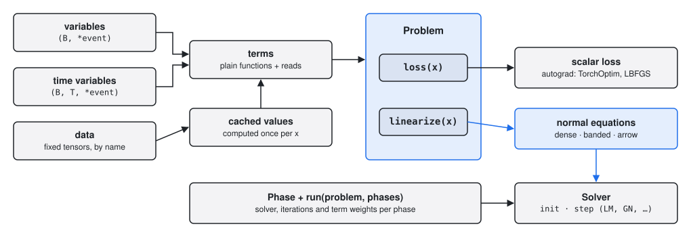

# Optimization

`better_robot.optim` minimizes a sum of terms over named tensors. After this page you can build a
`Problem`, write terms as plain functions, pick a solver, and check an analytic Jacobian.
The package imports torch and `better_robot.exceptions` only; robot terms live in `better_robot.terms`.

## A problem is variables, data and terms

A **variable** is a named tensor `(B, *event)` that the solver changes. All variables share the batch
size `B`, and the `B` problems of a batch are independent: each has its own loss, step and convergence
flag. **Data** are tensors the terms read but the solver never changes (targets, network outputs).
A **term** is a plain function. Its parameter names say what it reads: a variable, a data tensor or a
cached value.

```python
import torch
from better_robot.optim import LevenbergMarquardt, Problem, solve

torch.manual_seed(0)
problem = Problem({"x": torch.zeros(4, 2)}, data={"target": torch.randn(4, 2)})
problem.residual("fit", lambda x, target: x - target)
result = solve(problem, LevenbergMarquardt(), iterations=20)
assert result.x["x"].shape == (4, 2) and bool(result.done.all())
```



`Problem(variables, manifolds=, bounds=, data=, time=, dense=)` takes the rest as keywords:

| Argument | Meaning |
|---|---|
| `manifolds` | per-variable `Manifold` (`retract`, `project`); missing entries are `Euclidean` |
| `bounds` | per-variable `(lower, upper)`, enforced by clamping after every step |
| `data` | tensors the terms read; a `Phase` may refresh them |
| `time` | names of variables shaped `(B, T, *event)`, see [Time and structure](time-and-structure.md) |
| `dense` | force dense normal equations even when the banded form applies |

## Terms are functions

`residual(name, fn, weight=, kernel=, reads=, jacobian=, window=)` adds a least-squares term. `fn` returns
`(B, ..., k)` and its loss is `½ · weight · Σ r²`. `scalar(name, fn, weight=)` adds a term that already
returns a `(B,)` loss. `cached(fn, name=)` registers an intermediate that several terms read, such as a
kinematic state, and returns its name; it is computed at most once per evaluation. `problem.terms` and
`problem.cached_values` are read-only mappings of what is registered.

```python
problem = Problem({"x": torch.zeros(4, 2)}, data={"target": torch.randn(4, 2)})

@problem.cached
def doubled(x):
    return 2.0 * x

problem.residual("fit", lambda doubled, target: doubled - target)
problem.scalar("small", lambda x: (x**2).sum(-1), weight=1e-2)
print({name: tuple(value.shape) for name, value in problem.losses().items()})  # each (4,)
```
```output
{'fit': (4,), 'small': (4,)}
```

`reads=` overrides the parameter names when the function takes `*args` or its names clash.
A term never touches the solver: it maps tensors to tensors, so the same function serves autograd,
Gauss-Newton and your own loop. A term may also return `(value, info)`, where `info` is a dict of
diagnostics (a contact count, an inlier ratio) that is detached and never enters the loss;
`problem.evaluate(x)` returns the total loss, the per-term losses and these `info` dicts from one evaluation;
`problem.gradient(x)` returns the loss, its gradient in tangent coordinates and the per-term losses, also from one.

### Analytic Jacobians and `TermFn`

Without `jacobian`, the Jacobian comes from autodiff. A `TermFn(fn, reads, jacobian=, window=)` bundles a
function with what it reads and, optionally, an analytic Jacobian. `jacobian(*reads)` returns `{variable: (B, m, n)}`,
one block per variable in that variable's tangent coordinates, with the chain rule through any cached
value already applied. `window=k` declares a time-local term; see
[Time and structure](time-and-structure.md#windows-make-terms-time-local).

```python
from better_robot.optim import TermFn, check_jacobian

def fit_jacobian(x, target):
    return {"x": torch.eye(2).expand(x.shape[0], 2, 2)}

problem = Problem({"x": torch.zeros(4, 2)}, data={"target": torch.randn(4, 2)})
problem.residual("fit", TermFn(lambda x, target: x - target, reads=("x", "target"), jacobian=fit_jacobian))
errors = check_jacobian(problem)
assert errors["fit"] < 1e-6
```

`check_jacobian(problem, x=None)` compares every term that has a `jacobian` or a `window` with plain
row-by-row autodiff and returns `{term: error}`, measured on `H` and `g` relative to the largest entry of
`H`. Run it in a test for every term you write; [Write a term](../guides/write-a-term.md) walks through one.

### Robust kernels

`kernel=` makes the last axis of the residual one robust group: the loss becomes
`Σ kernel.rho(weight · ‖r‖²)`. `Huber(delta=)`, `Cauchy`, `GemanMcClure` and `Tukey` down-weight outliers.
A new kernel subclasses `RobustKernel` with `rho(s)` and `weight(s)`, which is twice the derivative of `rho`, so
that the plain loss `s / 2` has weight 1; `better_robot.testing.check_robust_kernel(kernel, dtype=, generator=)`
checks both.

```python
from better_robot.optim import Huber

problem = Problem({"x": torch.zeros(4, 2)}, data={"target": torch.randn(4, 2)})
problem.residual("fit", lambda x, target: x - target, kernel=Huber(delta=0.1))
```

## `loss` feeds autograd, `linearize` feeds Gauss-Newton

The same terms give two views of the problem.

- `problem.loss(x)` is an ordinary differentiable `(B,)` tensor. Any `torch.optim` optimizer can minimize
  it, and you can put it inside your own training loop ([Own the loop](../guides/own-the-loop.md)).
- `problem.linearize(x)` returns `(normal, loss)`: the Gauss-Newton normal equations $J^\top W J\,\delta =
  -J^\top W r$ and the `(B,)` loss. `normal` is a `Normal` (dense), a `BandedNormal` or an `ArrowNormal`;
  all three expose `solve`, `masked`, `restrict` and `predicted_decrease`, so solvers do not care which.

```python
normal, loss = problem.linearize(problem.variables)
print(type(normal).__name__, tuple(loss.shape))  # Normal (4,)
```
```output
Normal (4,)
```

A `scalar` term contributes its gradient to `linearize` but not its curvature, so Gauss-Newton and LM
treat it as a first-order term.

## Solvers are `init` and `step`

A solver subclasses the abstract `Solver`: `init(problem, x) -> State` and
`step(problem, state) -> State`, and `warm_keys` names the `State.extra` entries a warm start keeps. After each step a solver writes fixed diagnostic keys into `State.extra`,
each `(B,)`: `grad_norm`, `step_norm` and `accepted` (LM, Gauss-Newton, L-BFGS, `SequentialQP`), `damping` (LM,
`SequentialQP`) and `violation` (`SequentialQP`); the
`State` docstring is the reference for the key set. `State` holds `x`, the `(B,)` `loss`, the `(B,)` bool `done`,
`solver` (the class of the solver that made it), the step count `iteration`, and `extra` for solver-owned values
(damping, moments). LM and Gauss-Newton keep `extra["normal"]`, the normal equations at `x`: a step linearizes
once, at its candidate, and a candidate that is taken brings its linearization to the next step. Every solver also
writes
`extra["terms"]`, the detached `(B,)` loss of each active term from the evaluation `loss` comes from, and
`TorchOptim` writes `extra["info"]`, so a `Phase.on_step` logger needs no second forward.

| Solver | Uses | Notes |
|---|---|---|
| `LevenbergMarquardt(damping=, gradient_tolerance=, loss_tolerance=, step_tolerance=)` | `linearize` | per-problem damping, Marquardt scaling; the default choice |
| `GaussNewton(damping=0.0)` | `linearize` | full step, optional fixed damping; fast near a good start |
| `SequentialQP(damping=, gain=0.5, tolerance=1e-4, gradient_tolerance=, step_tolerance=)` | `linearize` and the constraint terms' rows | LM whose step is a quadratic program; the one solver that holds [constraint terms](#constraint-terms) |
| `LBFGS(history=10, line_search=20, stop_search=True)` | `loss` gradient | tangent coordinates, per-problem history; Armijo backtracking: each problem takes its first accepted step, the search stops once every problem has one (`stop_search=False` runs every trial and reads nothing back); the first trial carries its gradient, so a step that every problem takes there costs one evaluation; bounds by projection |
| `TorchOptim(lambda params: torch.optim.Adam(params, lr=...))` | `loss` | any `torch.optim` optimizer; projects onto manifolds and bounds after each step |

Because a solver is two functions, you can drive it yourself:

```python
solver = LevenbergMarquardt()
state = solver.init(problem, dict(problem.variables))
while not bool(state.done.all()) and state.iteration < 50:
    state = solver.step(problem, state)
print(state.iteration, state.loss)
```
```output
4 tensor([0., 0., 0., 0.])
```

## `solve`, `run` and friends

- `solve(problem, solver, *, iterations=50, x=None, state=None, step=None) -> Result` runs one solver until every
  problem is done or `iterations` steps pass; `step(problem, state)` replaces `solver.step`, for a step compiled once
  with `kinematics.compiled` and reused across solves. `Result.state` is the final solver state; passing it back as `state=` warm-starts
  the next solve with the same solver kind (LM keeps its damping, L-BFGS its curvature memory) from `x`, else
  `state.x`; a state from another kind raises `ArgumentError`. An `x` given to `solve`, `run` or a `Problem`
  method holds one `(B, *event)` tensor per variable and nothing else (it never overrides a data entry).
  `Result.diagnostics[phase][key]` stacks the diagnostic keys per step, `(steps, B)`.
  `Result` has `x` (the solved variables, `result.x["q"]`), `loss`, `done`, `iterations` and a per-phase loss
  `history`.
- `run(problem, phases, *, x=None)` chains `Phase`s, each with its own solver, weight overrides and frozen
  coordinates ([Fit a clip](../guides/fit-a-clip.md)). `Phase(stop_every=0)` runs exactly `iterations` steps and
  reads nothing back to the host, so the device never waits for Python (LM, Gauss-Newton,
  `LBFGS(stop_search=False)`, `SequentialQP`); `solve_ik` runs this way.
- `solve_layer(problem, solver, *, iterations=50, x=None, damping=1e-6)` returns the solution attached to the autograd graph of the data
  ([Own the loop](../guides/own-the-loop.md)).
- `solve_constrained(problem, solver, equalities=, inequalities=)` turns named terms into hard
  constraints with an augmented Lagrangian ([Hard constraints](../guides/hard-constraints.md)). Terms registered
  as [constraint terms](#constraint-terms) are held by `SequentialQP` instead, inside one solve.

Registration (`residual`, `scalar`, `equality`, `inequality`, `cached`) only adds names to the problem it is called on, and every field
of a registered term is fixed; changes go through `with_`. `problem.with_(data=, weights=, free=)` returns a
new problem with data entries added or replaced, term weights overridden (`0` switches a term off) and tangent
coordinates frozen by a bool mask `(n,)` or `(B, n)`; the original stays as it was. The new problem is sealed:
registering on it raises `ArgumentError`, so register every term before solving or deriving. The views that
`run`, `solve_constrained` and `solve_layer` make (the ones `Phase.on_start` and `on_step` receive) are sealed
too, so a callback cannot change the solve it runs in.

```python
from better_robot.optim import TorchOptim

loose = problem.with_(weights={"fit": 0.5})
result = solve(loose, TorchOptim(lambda params: torch.optim.Adam(params, lr=0.1)), iterations=100)
print(result.loss)
```
```output
tensor([2.3851e-07, 3.0286e-06, 1.1951e-06, 5.3854e-07])
```

## Constraint terms

`problem.equality(name, fn)` holds `fn(...) = 0` and `problem.inequality(name, fn, lower=, upper=)` holds
`lower <= fn(...) <= upper`, entry by entry of the output `(B, ..., k)`. Both take the function a `residual` takes,
a `TermFn` with its analytic Jacobian included, so one function serves as a cost or as a constraint:
`terms.self_clearance(..., hinge=False)` is a penalty under `residual` and the rows `margin - distance <= 0` under
`inequality(..., upper=0.0)`. A constraint term is no part of the loss. `SequentialQP` holds it; every other solver
raises `ArgumentError` on a problem with an active one, as `solve_layer` does.

```python
from better_robot.optim import SequentialQP

target = torch.tensor([[2.0, 0.0], [0.0, 3.0], [0.2, 0.1], [-1.0, -1.0]], dtype=torch.float64)
held = Problem({"x": torch.zeros(4, 2, dtype=torch.float64)}, data={"target": target})
held.residual("fit", lambda x, target: x - target)
held.inequality("disc", lambda x: (x * x).sum(-1, keepdim=True), upper=1.0)
result = solve(held, SequentialQP(), iterations=60)
print(result.x["x"])                                                        # the targets, pulled back onto the disc
print(bool((result.diagnostics["phase"]["violation"][-1] < 1e-6).all()))
```
```output
tensor([[ 1.0000,  0.0000],
        [ 0.0000,  1.0000],
        [ 0.2000,  0.1000],
        [-0.7071, -0.7071]], dtype=torch.float64)
True
```

Each step of `SequentialQP` is a [quadratic program](#a-quadratic-program-per-step): the damped Gauss-Newton model of
the loss, under the constraint terms linearized at the iterate and the problem's bounds as a box on the step. A term
with value $c$ and Jacobian $J$ gives the rows

$$\text{gain} \cdot (\text{lower} - c) \;\le\; J\,\delta \;\le\; \text{gain} \cdot (\text{upper} - c),$$

so one step uses at most `gain` of a row's distance to its bound and repairs `gain` of a violation. A term's `weight`
scales its rows and bounds; leave it at 1 unless rows are in conflict and one of them must win (`solve_qp`'s rows
are elastic). The number of rows must stay fixed between steps, because each program starts from the solution of
the last one (`State.extra["qp"]`, which a warm start keeps too): a clearance term picks its `closest=k` pairs.

A step is taken where it lowers the merit, the loss plus the summed violation of the rows times the largest
multiplier of the step's program, and the damping follows the ratio of that decrease to the predicted one. The
damping is what stands in for the curvature of the constraint terms, which linear rows do not carry. The iterate
may therefore leave a curved constraint by a little and come back; `State.x` is the last iterate that was within
`tolerance` of every bound, in the terms' own units (or the closest one, before any was). A solve that starts
within `tolerance` returns a point within it after any number of steps, and `Result.diagnostics[phase]["violation"]`
reports the largest distance from the bounds per step. `State.extra["iterate"]` holds the iterate itself.

Measured on 64 problems of three variables pulled to targets outside the constraint, in float64: every problem is
within `1e-6` of the closed-form optimum after 2 steps under a box, 20 on a plane (an equality; 3 with `gain=1.0`),
39 on the unit ball and 57 on the unit sphere, whose curvature the damping has to find. In float32 a problem whose
loss stays large at the optimum stops where a step's decrease drops under the rounding of that loss.
[Constrained inverse kinematics](../guides/constrained-ik.md) uses the solver on a robot and compares it with the
hinged cost and with `solve_constrained`;
[record 0055](../contracts/decisions/0055-constraint-terms-and-sequential-qp.md) has the alternatives.

## A quadratic program per step

`solve_qp(hessian, gradient, *, rows, lower, upper, iterations=20, weight=100.0, warm=None)` takes one step towards
the minimiser of $\tfrac12 x^\top H x + g^\top x$ subject to `lower <= rows x <= upper` for a batch of independent
problems: the step of a Gauss-Newton method under linear constraints. An equality is a row with `lower == upper`, a
one-sided row has an infinite bound, a box on `x` is identity rows, a padding row is a zero row with infinite
bounds, and a row whose `lower` is above its `upper` is the equality at `upper`. It is a building block: no solver
calls it yet.

```python
import torch
from better_robot.optim import solve_qp

hessian, gradient = torch.eye(2)[None], torch.tensor([[-2.0, 0.5]])
rows = torch.tensor([[[1.0, 1.0]]])  # x0 + x1 <= 1
solution = solve_qp(hessian, gradient, rows=rows, lower=torch.tensor([[-torch.inf]]), upper=torch.tensor([[1.0]]))
print(solution.x, solution.dual)
```
```output
tensor([[ 1.7500, -0.7500]]) tensor([[0.2500]])
```

A call runs a fixed number of cheap steps (ADMM in the OSQP form: one factorization, then three matrix-vector
products per step) and then solves the rows the multipliers press on as equalities. Where that point puts every row
where its multiplier holds it and makes the gradient vanish, both to a relative `1e-6`, and no row it holds asks
for a multiplier of the wrong sign or beyond the cap (below), it is the solution: it is returned and
`solution.exact` is set, as above. A point that would need such a multiplier cut is refused, because along a
direction of weak curvature the small gradient the cut leaves is far from the minimiser. Elsewhere the last step is
returned, and `solution.primal_residual` (largest distance of a row from where its multiplier holds it: its
violation, or how far a row that is pressed on sits off its bound) and `solution.dual_residual` (largest entry of
`H x + g + rowsᵀ dual`) say how far it is, in the caller's units.

Small residuals bound the gap in the objective, not the distance to the minimiser. On problems shaped like damped
inverse kinematics (damping `1e-4`), steps up to `1.6e-2` from the minimiser reported a primal residual of 0 and a
dual residual under `1e-4`, with an objective at most `1.4e-6` above the minimum. `exact` is the sign that a step
is the minimiser.

One call is a step, not a solve. Pass the last `QPSolution` as `warm=` to the next call (the next step of a solver,
the next tick of a control loop): it carries `x`, `dual` and the row weight (`penalty`) the last call tuned, and the
calls add up while the problem changes little. Accuracy comes from these warm calls, not from `iterations`: the
penalty that sets the pace of the steps is tuned between calls. On random feasible problems with half of the rows
active and $\mathrm{cond}(H) = 10^4$, a problem counts as solved when both residuals are under `1e-8`:

| Calls | 7 variables, 30 rows: solved of 256 | median violation | 35 variables, 150 rows: solved of 128 | median violation |
|---|---|---|---|---|
| one cold call of 20 iterations | 0 | 0.33 | 0 | 0.50 |
| one cold call of 500 iterations | 0 | 0.062 | 0 | 0.13 |
| 5 warm calls of 20 iterations | 47 | 0.0064 | 0 | 0.029 |
| 12 warm calls of 20 iterations | 181 | 7e-16 | 0 | 0.0055 |
| 40 warm calls of 20 iterations | 247 | 4e-16 | 44 | 2.5e-4 |

A warm call started at the minimiser stays there: each row starts from its value at the given `x`. The rows bound
the step only in the limit: at $\mathrm{cond}(H) = 10^8$ one cold call of 20 iterations returned steps up to 35
against a box of 0.3, and five warm calls 0.30; `primal_residual` reports such a step.

The rows are elastic. Each problem has a cap, `weight` times the larger of $\lVert g\rVert_\infty$ and the largest
diagonal entry of $H$. A row gives way once holding it would take a multiplier beyond the cap, so the problem solved
is $\tfrac12 x^\top H x + g^\top x + \text{cap} \cdot \sum_i \text{violation}_i$ and no multiplier passes the cap.
Rows that can all hold with smaller multipliers are held exactly. Rows that cannot all hold give the L1-elastic
minimiser for that cap: a row gives way where holding it would cost the objective more than the cap per unit of its
violation, in the units the row is given in, and `primal_residual` stays positive (only `exact` says that a step is
this minimiser). As `weight` grows, that point tends to the least sum of violations and, among those, the least
objective. It may break one row by much where a least-squares compromise would break many by little, and the row
that gives way may be a box row: scale the rows of a box up when the box must win. Scaling a row and its bounds by
$t$ counts its violation $t$ times and lets the row push $t$ times harder.

The cap scales with the objective, so `weight` is a pure number; comparing a multiplier with a gradient assumes rows
whose coefficients are of order one and variables in natural units. With the default `100.0`, no row of a feasible
problem had to give way on problems shaped like inverse kinematics with the objective scaled by 1 to 3000 (the
multipliers needed stayed at least 28 times under the cap), and rows that had been in conflict let go within 7
warm calls at 7 variables and 23 at 35 variables with 150 rows. A zero row whose bounds exclude 0 never holds: its
multiplier stays at the cap and the other rows are solved as without it.
The solve runs in float64, the same steps for every batch element, with no host read, and returns no gradient
([record 0054](../contracts/decisions/0054-quadratic-programs-by-admm-and-one-active-set-step.md)).

## Reserved vocabulary

Every variable has exactly one batch axis `(B, *event)` ([C-TENS-5](../contracts/02-tensors.md)). A
`time=` problem whose time-local terms are mixed with a term that reads a time variable without `window=`
falls back to dense normal equations and warns; declare `window=` or pass `dense=True`.

The term kinds are `residual`, `scalar`, `equality` and `inequality`.

## Where next

- [Time and structure](time-and-structure.md): trajectories, windows and the banded solve.
- [Write a term](../guides/write-a-term.md): a custom term with an analytic Jacobian.
- Robot terms (`frame_pose`, limits, collision, `ik_problem`) are in `better_robot.terms`;
  see [Inverse kinematics](../getting-started/inverse-kinematics.md).
