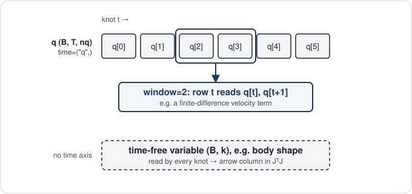
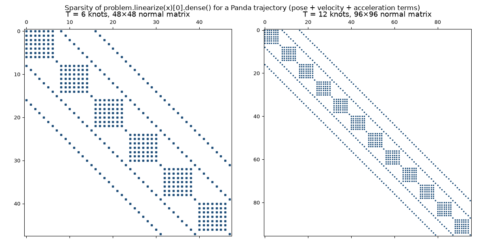
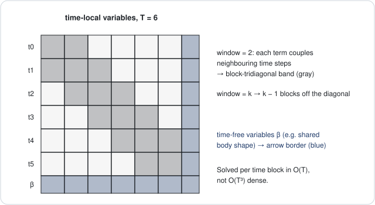

# Time and structure

A trajectory has a time axis, and most of its terms look at only a few neighbouring knots. This page shows
how to tell the optimizer that, why it turns the solve from cubic into linear in the number of knots `T`,
and how to stage a solve in phases with `run`.

## Time variables are `(B, T, *event)`

`Problem(time=("q",))` declares that the variable `q` is shaped `(B, T, *event)` and that its second axis is
time. Each slice `q[:, t]` is a **knot**. Variables not listed in `time` (body shape, a camera, a mass) stay
`(B, *event)` and are shared by every knot.

{ width=760 }

*A window-`k` term reads `k` consecutive knots of `q`; a time-free variable such as body shape feeds every knot.*

## Windows make terms time-local

`window=k` on `residual` declares a time-local term: the output is `(B, T - k + 1, m)` and row `t` depends
only on knots `t .. t + k - 1`. Use `k=1` for a per-knot term, `k=2` for a velocity, `k=3` for an
acceleration.

```python
import torch
from better_robot.optim import LevenbergMarquardt, Problem, check_jacobian, solve

torch.manual_seed(0)
B, T = 2, 30
problem = Problem({"x": torch.zeros(B, T, 2)}, data={"target": torch.randn(B, T, 2)}, time=("x",))
problem.residual("track", lambda x, target: x - target, window=1)
problem.residual("velocity", lambda x: x[:, 1:] - x[:, :-1], weight=10.0, window=2)
problem.residual("acceleration", lambda x: x[:, 2:] - 2 * x[:, 1:-1] + x[:, :-2], weight=1.0, window=3)

normal, loss = problem.linearize(problem.variables)
print(type(normal).__name__)  # BandedNormal
assert max(check_jacobian(problem).values()) < 1e-6
```
```output
BandedNormal
```

The window does two things. Autodiff of a windowed term costs `k · m` backward passes instead of one per
row, because rows that do not share knots can be differentiated together. And the normal matrix
`H = JᵀWJ` is zero outside a band around the diagonal. The declaration is trusted: a row that reads outside
its window gives a wrong Jacobian with no error, so run `check_jacobian` once in a test.



The plot is `problem.linearize(x)[0].dense()` for the Panda problem of `examples/02_trajectory.py` with a
per-knot pose term and the velocity and acceleration terms. Each knot has 8 tangent coordinates; the
acceleration term (window 3) couples a knot with the two after it, which gives the outer bands.

## Three normal-equation types, one interface

`linearize` picks the storage from the terms. You never choose it, but it explains the cost.

| Type | When | Storage |
|---|---|---|
| `BandedNormal` | every residual term is time-local or reads no time variable, and there are only time variables | block-tridiagonal: `diagonal (B, K, S, S)`, `upper (B, K - 1, S, S)` |
| `ArrowNormal` | as above, plus variables without a time axis | a `BandedNormal` bordered by the shared columns (`border`, `corner`) |
| `Normal` | anything else, or `Problem(dense=True)` | dense `(B, N, N)` |

Knots are grouped into super-blocks of `S` coordinates so that any window spans at most two neighbouring
super-blocks; the matrix is then block-tridiagonal in `K` super-blocks. All three types have `solve`,
`masked`, `restrict` and `predicted_decrease`, so every solver works with every type.



A variable without a time axis turns the band into an arrow. A windowed term that reads one returns its
analytic Jacobian blocks as `(B, T - k + 1, m, k, n)` per time variable and `(B, T - k + 1, m, n)` per shared
variable:

```python
from better_robot.optim import TermFn

problem = Problem(
    {"x": torch.zeros(B, T, 2), "offset": torch.zeros(B, 2)},
    data={"target": torch.randn(B, T, 2)},
    time=("x",),
)
def track_jac(x, offset, target):
    eye = torch.eye(2).expand(B, T, 2, 2)
    return {"x": eye[:, :, :, None, :], "offset": eye}  # (B, T, m, k, n) and (B, T, m, n)

track = TermFn(lambda x, offset, target: x + offset[:, None] - target,
               reads=("x", "offset", "target"), jac=track_jac)
problem.residual("track", track, window=1)
problem.residual("velocity", lambda x: x[:, 1:] - x[:, :-1], weight=10.0, window=2)
problem.residual("offset_prior", lambda offset: offset, weight=1e-2)

normal, _ = problem.linearize(problem.variables)
print(type(normal).__name__)  # ArrowNormal
result = solve(problem, LevenbergMarquardt(), iters=30)
```
```output
ArrowNormal
```

## The cost of a solve is linear in `T`

`BandedNormal.solve` runs a block-tridiagonal Cholesky factorization in float64: `K` factorizations of
`S × S` blocks, so the cost is `O(K · S³)`, linear in `T`. `ArrowNormal` eliminates the time part with the
same banded factorization and then solves a small dense system the size of the shared variables. A dense
`Normal` of the same problem costs `O((T · n)³)`. Solve time for 40 knots of a Panda is in
`examples/02_trajectory.py`, which prints it.

One thing breaks the band and falls back to `Normal` without a warning: a residual term that reads a time
variable but has no `window`. A `scalar` term does not break it; it adds only a gradient. If a trajectory solve is
slow, print `type(problem.linearize()[0]).__name__`.

## Phases stage a solve

A hard fit often needs stages: fit the coarse terms first, then switch on the fine ones; freeze shared
variables, then release them. `run(problem, phases)` chains `Phase`s. Each phase has its own solver and
iteration count, `weights` overrides by term name (`0` switches a term off), and `free` masks tangent
coordinates per variable (`False` freezes). The next phase starts from the previous phase's solution.

```python
from better_robot.optim import Phase, run

phases = [
    Phase(LevenbergMarquardt(), iters=20, name="smooth", weights={"track": 0.1},
          free={"offset": torch.zeros(2, dtype=torch.bool)}),
    Phase(LevenbergMarquardt(), iters=30, name="fit"),
]
result = run(problem, phases)
print(result.iters, {name: tuple(h.shape) for name, h in result.history.items()})
```
```output
28 {'smooth': (15, 2), 'fit': (13, 2)}
```

`Phase.on_start(problem, x)` runs before the first step and may return new variables or refresh
`problem.data` (the phase's own copy), for example contact labels; `on_step(problem, state)` runs after each
step for logging. `Result.history[name]` is the `(steps, B)` loss of each phase. A full example with weight
schedules and free masks is [Fit a clip](../guides/fit-a-clip.md).

## Where next

- [Optimization](optimization.md): terms, solvers and `check_jacobian`.
- [Trajectories](../getting-started/trajectories.md): the Panda trajectory tutorial.
