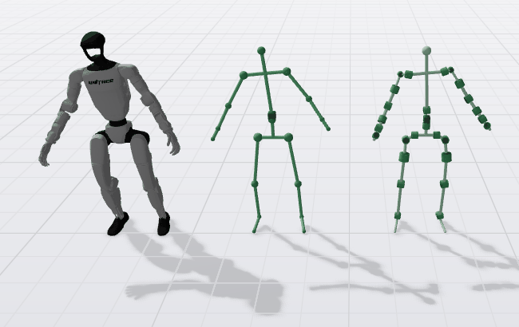
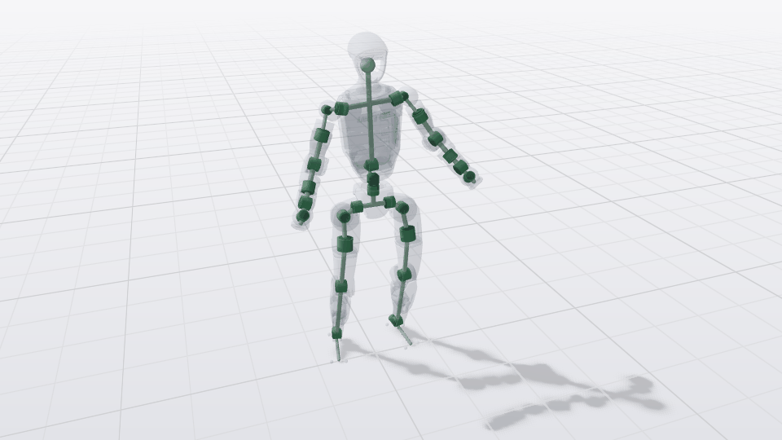

# Viewer

The viewer shows robots, bodies and data clips in a browser, and records the same scene through a headless
Chromium to an `.mp4` or `.webm` video or a `.png` still. After this page you will know its four ideas (layers, tags, one timeline, headless record)
and which call to reach for: `show`, `serve`, `save` or `record`.

It lives in `better_robot.viewer`, is built on [viser](https://viser.studio), and is the top of the import stack:
nothing else in the library imports it. viser is imported only when you create a `Viewer`.

<figure markdown="span"><video autoplay loop muted playsinline preload="metadata" poster="../../clips/viewer_layers.png" width="960"><source src="../../clips/viewer_layers.webm" type="video/webm"></video><figcaption>One <code>RobotVisual</code> six ways: meshes, the minimal, medium and maximal skeletons, the maximal one with joint frames, and the medium one under the collision glass, switched with <code>set_style</code>, <code>set_frames</code> and <code>set_collision</code>.</figcaption></figure>

## A layer holds a whole clip

A `Layer` is one named thing in the scene: a point cloud, a skeleton, rigid meshes, coordinate frames, arrows.
You give it every frame up front as numpy arrays with a leading time axis `(T, ...)`. Static input counts as
`T = 1`. The layer keeps them as float32 attributes (`points.points`, `frames.poses`, ...) that it reads at every
push, so editing one in place and calling `layer.redraw()` updates the scene without rebuilding anything; so does
`SpheresLayer.radii`, while a skin's rest arrays (`vertices`, `bind_poses`, `weights`) and a chart's `series` are sent
once, when the layer is built. A C-contiguous float32 input is that attribute itself, no copy, which keeps a big cloud
in memory once; any other input (numpy's default float64, a strided view, a list) is converted once, so edit the
layer's attribute, not your input.


```python
import numpy as np
from better_robot import Viewer
from better_robot.viewer import PointsLayer

viewer = Viewer()                        # viser server on http://127.0.0.1:8080, with a ground grid
cloud = np.random.rand(100, 50, 3)       # T = 100 frames of 50 points
points = viewer.add(PointsLayer("cloud", cloud))   # one layer, or an iterable of layers
print(viewer.url, viewer.timeline.nsteps)
```
```output
http://127.0.0.1:8080 100
```

The built-in layers are `RobotVisual` (a whole robot, below), `PointsLayer`, `LinesLayer`, `FramesLayer`,
`ArrowsLayer`, `GroundLayer`, `RigidMeshLayer`, `MeshLayer`, `SpheresLayer`, `SkinnedMeshLayer` and `CameraLayer`. Each layer of data takes its name and
its main array by position and every other argument by keyword, as in `SpheresLayer("contacts", centers, radii=radii)`.
`viewer.add_plot` adds a
`PlotPanel` of time series to the GUI, and `ImagePanel(name, images)` puts an image per step there, such as the input
video (`(T, H, W, 3)` uint8, or a callable `step -> image` with `nsteps=`). `PointsLayer`, `LinesLayer`,
`SpheresLayer` and `ArrowsLayer` take one colour, one per element `(N, 3)`, or one per step `(T, N, 3)`, such as a
contact turning red or green. A list of `(N_t, 3)` arrays makes a `PointsLayer` whose size changes per step
(detections, a growing map); a step without points hides it. `LinesLayer(name, points)` draws segments
`(T, N, 2, 3)` (start, end) `width` pixels wide, in the theme's text colour unless given `colors`.
`MeshLayer(name, vertices, faces=, colors=(V, 3))` colours each vertex, the same colours at every step: a static
mesh blends them across each face, a deforming one draws one scene node per distinct colour (at most 64), each face
in its first vertex's colour.
`CameraLayer(name, poses, intrinsics=K, size=(W, H))` draws a pinhole camera's frustum from its intrinsics, an
off-centre principal point included, cut `scale` metres in front of the camera, with an optional image on the cut.
`ArrowsLayer` draws viser's solid arrows, a cylinder of `shaft_radius` and a cone of `head_radius` and `head_length`
(metres, the same for every arrow), so forces keep their thickness at any zoom; an arrow shorter than its head is all
head. An arrow of at most `min_length` metres (default `1e-6`: exact zeros and float noise) is left out of the step;
raise it to hide forces too small to read. A new layer type subclasses `Layer` and implements
`build` (create scene nodes once), `set_step` (move them to step `k`) and optionally `bounds` (the box
`aim` frames), `apply_theme` and `build_gui` (its controls in the sidebar).

## A tag is the unit you toggle, move and remove

Every layer carries tags, by default its own name; `viewer.add(layers, tags="...")` gives every layer of the call
those tags instead. A layer lives under the scene node `/<first tag>/<layer.name>`. `remove`, `set_visible` and
`redraw` take a layer or a tag (every layer carrying it), and once there are two tags the sidebar's Layers section
has one checkbox per tag, labelled in sentence case (the ground's tag `ground` and tags that hold only sidebar
charts or images are not listed). `remove` shrinks the timeline to the longest
remaining layer, so a clip browser can remove one clip's tag before adding the next. Layer names must be unique
under a first tag, and a tag that `set_pose` or `remove` does not know raises `UnknownNameError`.

A layer is changed through its own methods, never its fields: `viewer.set_visible(layer, False)` hides it,
`layer.set_opacity(0.4)` fades a mesh layer (`RigidMeshLayer`, `MeshLayer`, `SpheresLayer`, `SkinnedMeshLayer`,
every style of a `RobotVisual`; a layer without surfaces raises `ArgumentError`), and `viewer.replace(old, new)` swaps the data a layer draws, such
as a body switched in a studio: `new` takes `old`'s tags, place, sidebar controls and visibility, the current step is
pushed and the camera stays.

```python
viewer.add(PointsLayer("noise", 0.01 * np.random.randn(1, 200, 3)), tags="debug")
viewer.remove("debug")
```

`add(..., pose=(x, y, z))` moves the layers' first tags, in the browser, in `aim`, `record` and `save`, which is how
you put two clips side by side; `set_pose(tag, pose)` places a tag again later, such as from a spacing slider. A pose
`(7,)` `[x, y, z, qx, qy, qz, qw]` also turns the tag's frame, so data recorded with another up axis stands beside
the rest without touching its arrays: a quarter turn about `+x` stands a y-up body upright in a z-up scene.

```python
import math

turn = (math.sin(math.pi / 4), 0.0, 0.0, math.cos(math.pi / 4))  # a quarter turn about +x: +y up becomes +z up
body = np.array([[0.0, 0.0, 0.0], [0.0, 1.8, 0.0]])  # a 1.8 m figure stored y-up
viewer.add(PointsLayer("y_up", body), tags="y_up", pose=(0.0, 1.0, 0.0, *turn))  # stands 1 m along +y, upright
```

## The sidebar, the camera and the theme

`viewer.sidebar` holds the controls in sections with a fixed order: Timeline, Robot, Layers, Plots, Images, then the
sections an application creates, Info last. The Timeline section, shown once the timeline has more than one step, holds a
Play box, the Step slider, a Speed choice (0.25x to 2x, taken while playing) and Loop. `sidebar.checkbox`, `dropdown`, `slider` and `button` take a section and a label
and return viser's control; asking again for the same section and label returns the same control and adds the
callback, so one control drives every layer that asked for it, and it goes when the last of them is removed.
`sidebar.set_value(section, label, value=)` shows a value on a control without running its callbacks, for a layer
whose state code changed. Every
callback runs under `viewer.lock`, the one lock of adding, removing and pushing steps; it may call `set_fps` or
`record`, which pause playback. A callback that raises a
`BetterRobotError` shows it as a red notification in the browser and the control returns to its previous value.

Until you call `aim`, the viewer points the browsers' camera at the scene after each `add`: the boxes of the visible
layers' `Layer.bounds` over their whole clips (at most 32 evenly spaced samples of each layer are read), centred in a
front three-quarter view of a robot facing `+x` at the nearest distance where every corner of every box lies inside
four fifths of a 16:9 view. Each sample's boxes are read once and again only after a push that follows an edit
(`redraw`, `show()`, `set_visible`, `RobotVisual.update`); a step change, playback or a longer timeline keeps them,
so the sixteenth robot added costs what the first did. `aim(steps=, azimuth=, elevation=, fov=)` chooses the view yourself
and reads every visible layer afresh.

## One timeline drives every layer

The `Viewer` owns one `Timeline` of integer steps at `fps`. Its length follows the longest layer; a layer
shorter than the timeline holds its last step. `show(k)` is the only place steps reach the layers: every visible
layer gets its sample for step `k` inside one atomic server update, and layers already on that sample are skipped.
`show()` with no argument re-pushes the current step to every layer; `layer.redraw()` re-pushes one layer, which is
what you call after editing its arrays in place.

A layer recorded at another rate passes its sample times in seconds: `viewer.add([layer], times=t)` with `t` of
shape `(T,)`, non-decreasing. Step `k` then shows the latest sample at or before `k / fps`, so a 10 Hz layer and a
30 Hz layer play in sync on a 30 fps timeline. Without `times` (the default) sample `k` is shown at step `k`. The
layer itself still receives a plain integer sample index in `set_step`. `viewer.set_fps(f)` changes the rate of the
timeline itself, keeping one step per frame of the clip on screen; a clip browser calls it when it switches clips.

```python { .no-run data-reason="names a clip, markers_10hz, that this page does not build" }
viewer.add([PointsLayer("mocap", markers_10hz)], times=np.arange(len(markers_10hz)) / 10.0)
```

`viewer.add([layer], valid=v)` with a bool `v` of shape `(T,)` hides the layer on the samples where `v` is false, such
as a person who is not tracked in that frame; its sidebar switch stays on. A `(T, N)` mask hides single spheres of a
`SpheresLayer` or arrows of an `ArrowsLayer`. The layer keeps `v` as `layer.valid`, beside its other arrays. One
`add` gives its one mask to every layer of the call, so layers with masks of their own take an `add` each.

```python
viewer.show(10)
points.points[:, :, 2] += 0.5   # edit the layer's clip in place ...
viewer.show()                   # ... and re-push step 10
print(round(float(points.points[10, :, 2].mean() - cloud[10, :, 2].mean()), 3))   # your float64 cloud is as it was
```
```output
0.5
```

The other three calls consume the timeline:

| Call | What it does | Needs a browser |
|---|---|---|
| `serve()` | plays by wall clock at `fps` and blocks until Ctrl-C | yes, to watch |
| `save(path)` | writes a `.viser` recording for viser's static web client | no |
| `record(path)` | draws the scene in a headless Chromium into an `.mp4` or `.webm` video or a `.png` still | no |

```python { .no-run data-reason="blocks until Ctrl-C" }
viewer.serve()  # plays and blocks until Ctrl-C
```

## A robot is one layer

`RobotVisual(model, q)` is a whole robot: it runs forward kinematics once over `q`, one configuration `(nq,)` or a
clip `(T, nq)` (`None` is `model.q_neutral`), and draws the result in one of four styles.

| Style | Draws | Needs |
|---|---|---|
| `"meshes"` | the display shapes of a `Geometry` (`io.load_geometry`), or a `Skin` | `geometry=` with display shapes, or `skin=` |
| `"maximal"` | a skeleton with one glyph per joint, limbs, trunks and the ends of the chains | nothing but the model |
| `"medium"` | the maximal glyphs on thin pale rods, no bodies | nothing but the model |
| `"minimal"` | a stick figure: one ball per cluster of close joints, sticks between | nothing but the model |

{ width="960" }

`style=None` picks `"meshes"` when there is something to show as meshes and `"maximal"` otherwise. Mesh files are
looked up under `root`, the description file or its folder, and under each folder above it, so `root=` is the path
you loaded. Code without a viewer reads the same files the same way: `load_meshes(geometry, root=path)` returns one
`MeshSpec` per display shape (`collision=True`: per collision shape), `vertices (V, 3)` and `faces (F, 3)` with the
`body` it hangs on and its placement `origin (7,)` in that body's frame. `collision=True` overlays the collision model, the `spheres` (a `RobotSpheres`) when given, otherwise
the collision shapes of the geometry, as a pale see-through shell over any style (`Theme.collision` at
`Theme.collision_opacity`, casting and catching no shadow). The shell stands 0.2 % of the robot's size off its
shapes, along their normals (2 mm on a 1 m arm): viser has no depth offset, and glass on the very surface of a
display mesh (a G1 names one file for both) shows stripes of each in turn. `frames=True` draws a triad at every
moving joint and `frames=[...]` at the frames listed, by id or name, each as large as the maximal skeleton's glyph of
its joint, so a finger's triad is a finger's size and a hip's a hip's.

```python
import torch
import better_robot as br
from robot_descriptions import panda_description
from better_robot.viewer import RobotVisual

URDF = panda_description.URDF_PATH
model = br.load(URDF)
geometry = br.io.load_geometry(URDF, model)
phase = torch.linspace(0.0, 2 * torch.pi, 30)[:, None]
mid = (model.lower_position_limit + model.upper_position_limit) / 2
half = (model.upper_position_limit - model.lower_position_limit) / 2
q = mid + 0.5 * half * torch.sin(phase + torch.arange(model.nq) * 0.7)   # q (30, nq)

robot = viewer.add(RobotVisual(model, q, geometry=geometry, root=URDF, frames=["panda_hand"]))
ghost = viewer.add(RobotVisual(model, q, name="ghost", style="minimal"), pose=(0.0, 1.0, 0.0))
ghost.update(q.flip(0))            # the same clip played backwards: one kinematics pass, then a redraw
robot.set_style("maximal")         # built now, the first time it is shown; "meshes" stays in the scene, hidden
print(robot.style, robot.styles, ghost.styles)
```
```output
maximal ('meshes', 'minimal', 'medium', 'maximal') ('minimal', 'medium', 'maximal')
```

Each part (a style, the collision overlay, the frames) is built the first time it is shown and only hidden after
that, so switching back creates nothing, and a step is written only to the parts on screen. A hidden robot builds
nothing: a part switched on while it is hidden is built when it is shown, so a Style choice with seven robots kept
hidden builds one skeleton. `set_style`,
`set_collision` and `set_frames` switch them from code; the sidebar's Robot section has the same three controls,
shared by every robot in the viewer; a switch from code moves the control and leaves the other robots as they are,
and a robot added later keeps its own style, collision and frames and moves the controls to them (`robot.style`,
`robot.collision` and `robot.frames` read what a robot shows). The Style dropdown offers the
styles of the robots still shown: removing the one robot with meshes takes `"meshes"` away, and a dropdown that showed
it shows the first style left while every robot keeps its own; a robot that replaces another keeps its `style=`. `update(q)` shows new configurations of the same number of steps, or one `(nq,)` at
every step, for a live solver; a clip of another length is a new visual (`viewer.replace(old, new)`). Each robot takes the first of the
theme's hues that no other robot of the viewer is drawn in, unless `hue=` names one, so a robot that replaces
another takes its hue back; `robot.hue` is the colour it is drawn in. The name defaults to the model's, so two robots of
one model need a `name=` each, and `B` rollouts `(B, T, nq)` are `B` visuals, `q[b]` each.

### The skeleton

The three skeleton styles are laid out by a `SkeletonRecipe`; `MAXIMAL`, `MEDIUM` and `MINIMAL` are the presets
and `RobotVisual(maximal=, medium=, minimal=)` takes your own. Sizes come from the robot: every radius is a fraction
of the robot's size, so a hand and a humanoid read the same on screen. The layout is computed once, at
`model.q_neutral`, and every block is rigid in one joint frame, so a step only moves blocks.

`MAXIMAL` draws what the joints are, in two tones of the robot's hue: joints in the hue, bodies pale.

- a revolute joint is a drum along its axis, with dark end faces that show which way the axis points; a prismatic
  joint is a sleeve that rides with its child on a rail that spans the joint's travel in the parent; a spherical
  joint is a ball, and no other ball sits among the drums, where it would read as a ball joint; a planar joint (a
  mobile base) is a thin plate in its plane, a translation joint a small block, a free base a cube, and a kind
  defined outside the library a small ball;
- a glyph is as large as the motor that would carry its subtree: 26 mm times the cube root of that mass in kg, kept
  between 0.65 and 1.2 reference radii, so a wrist is smaller than its elbow, a chain narrows towards its tip, and a
  wrist, an ankle or a knee still reads as a motor at the distance of the whole robot (a joint inside a chain that
  carries grams, a finger of a hand on an arm, is at most twice its mass size instead, and a joint that ends a
  chain at least half a reference radius and no thicker than the body it moves);
- a drum is never thinner than a limb it joins: its radius is at least the limb's half width over 0.8, so both its
  faces stand out of the limb (a Go2's knee under its thigh, a UR5e's joints between its tubes, a Panda's base
  collar under its shoulder drum, whose link runs along the collar's axis);
- no two joint glyphs go inside each other, neighbours in the tree or not: the larger glyph nearer the root keeps
  its place (a drum on the root body's mid plane with its axis across it first, so a waist stays symmetric), and
  each later glyph that would touch one slides along its own axis until it clears it, so it stays on its true axis
  line; when that takes more than 1.75 of its radii it shrinks, down to 0.7 of its size, and slides less, else it
  slides farther at 0.7, and only where no slide clears does it shrink further; a glyph that clears at no size down
  to a tenth of its own is not drawn (a hand whose finger joints sit 7 mm apart). Joints that share a point, such
  as a hip's pitch, roll and yaw, so come out as a short staggered stack of separate drums, mirror joints as mirror
  images;
- a limb joins each joint to its parent: a faceted block that narrows towards the child, `bones` times the glyph
  radius wide, or 0.7 of its link's thinner half width when that is more, up to 0.8 of the radius its mass gives
  (a thigh is wider than its shin); where it is wider than a drum it joins, it starts or ends on the drum's side, so
  the drum stays in sight (`bones=0` draws none);
- a trunk, a block that narrows towards the joint it hangs from, stands for the root body and for every body where
  the tree branches (a torso, a pelvis, a palm), and stops short of the drums of its own waist and of its neck; a
  fixed base also of the collars that stand on it, keeping half its height (an iiwa's base joint, an Allegro's
  finger bases), which would otherwise show only their rims. A
  fixed base that carries one joint reaches at most 4 of that joint's glyph radii from its centre, shrunk towards
  the joint: an arm's stand (about 3) keeps its box, a Shadow hand's forearm becomes a block about the size of the
  hand, and the bones of a fixed base stay inside its box. A head is a ball that stands above the trunk and every joint: the head of a neck chain (a Talos, an Atlas), a
  round second frame of the trunk, or over a trunk whose sensor frames rise above it (an H1); a quadruped's snout
  or the lidar on its back is no head. A body that ends a chain is a sole when it is flat, a block when a prismatic
  joint moves it (a finger), else a limb that tapers to the end of the body (a hand, a paw), with no ball at its
  tip. Their sizes come from the collision shapes of the geometry, else from the sphere set, else from the
  inertias, so a sphere set shown as the collision overlay does not change a robot that has collision shapes. A
  collision mesh file that cannot be read is left out with a warning that names it, while the collision overlay,
  which draws the file, raises `ModelError`. `hulls="all"` also gives a trunk to the bodies with one child joint,
  `"none"` draws neither; `body_hull={frame: bool}` decides one body.

`MINIMAL` draws the least that still reads as the robot: joints closer than `cluster` times the robot's size share
one ball (a three-joint shoulder is one ball), a joint that only twists its limb gets none (`twists=False`), and
sticks join the balls. A leaf joint's stick runs on to the end of its body and ends in a small ball, rigid in the
leaf's frame: to the far end of its geometry (the paw of a Go2, the toe of a G1's sole, a hand, a finger), so
the figure stands on its feet; without geometry, to its farthest frame when that frame lies past the middle of the
body its inertia spans (a foot, a tool tip). The maximal limb of a hand or a paw ends at the same place. A
trunk's head is a ball as small as a joint's, on a stick from the trunk (here a quadruped's snout counts). Balls
and drums follow one size rule: the reference radius is a third of the mean bone, kept between 2 % and 3 % of the
robot's size, and `MINIMAL` draws it at 0.62.

`MEDIUM` sits between them: the joints as `MAXIMAL` draws them (a glyph per kind, at 0.7 of their size, laid out
by the same slide rule) and the bodies as `MINIMAL` does, thin rods (0.35 of the glyph radius) in the pale body
shade from glyph to glyph, a rod on to the end of each body that ends a chain, closed by a round cap of its own
width, and the heads of `MAXIMAL` as small pale balls. A drum is at most 0.35 of its shortest
rod, so a wrist reads motor, rod, motor, and at least 2.5 rod radii, and a rod is no thicker than 1 / 2.5 of the
drums it joins, so every drum stands out of its rods; a free base's cube is laid out with the drums, so a waist's
drums clear it. It is the recipe `SkeletonRecipe(bones=0.35, hulls="none", size=0.7)`: with `hulls="none"` a
skeleton of glyphs is a stick figure too. With no bodies drawn, the collision overlay is what shows the robot's
volume around its motors.

{ width="560" }

All three take `limits=True` (an arc over each bounded revolute joint's range with a tick at the current angle),
`sides=True` (the left side lighter, the right darker), `size` (a multiplier of every glyph), `joint_size={joint:
multiplier}` and `color={joint or frame: rgb}`. A `joint_size` factor scales that one glyph after the size rules:
0 hides it and the bones run on through its place, the glyphs after it keep their size, and above 1 it may be wider
than the glyph before it; a minimal ball takes the mean factor of its joints.

```python
from better_robot.viewer import MAXIMAL, SkeletonRecipe

recipe = SkeletonRecipe(limits=True, sides=True, joint_size={"panda_finger_joint2": 0.0})
viewer.add(RobotVisual(model, q, name="limits", maximal=recipe), pose=(0.0, -1.0, 0.0))
print(MAXIMAL.glyphs, MAXIMAL.hulls, recipe.limits)
```
```output
kind auto True
```

A skeleton is at most three batched nodes, one per unit mesh (cylinder, ball, box), plus one line node for the
limit arcs; with the sphere overlay and the frames a robot is at most six drawing nodes, while an overlay of
collision shapes is one node per shape (17 on the Panda), and a step writes positions and rotations to each node on
screen (the sticks of a minimal skeleton and the rods of a medium one also their lengths). Each mesh file is read
once per robot, however often its style, overlay or theme is switched. `bounds` is
a box per joint, per collision sphere and collision shape that is not a mesh (exact), a point per furthest vertex of
a collision mesh in 114 directions, per block of the medium skeleton on a body without one, and per bone of a skin that carries vertices (no vertex is skinned), in every style, so `Viewer.aim` frames a robot the same way whatever it is drawn as,
and by what it covers: one box round a moving robot is about twice that on screen. Its lowest point is the lowest
point of a sole or a foot with a collision shape: `examples/viewer/00_showcase.py` lifts a floating base by it, step
by step, and a fixed base by its lowest over the loop, to stand the robot on the ground.

### A ghost and joint values

`opacity=0.35`, or `robot.set_opacity(0.35)` while the viewer runs, draws every style of a robot see-through: a
ghost of a target or a reference motion beside or over the robot itself. Below 1 it casts and catches no shadow, a
mesh file with its own colours or texture keeps them at that opacity (its material is made see-through), and the
collision overlay and the triads keep their own look. The sidebar has no
opacity control: the Robot section's controls are shared by every robot, so one slider would fade a ghost and its
solid twin alike; an application adds its own slider in its own section.

`joint_values=` colours the joint glyphs of the skeleton styles at each step, such as each joint's load
`|tau| / effort limit`: one value per model joint, `(T, njoints)` with the visual's `T`, or `(njoints,)` for every
step of any clip (kept as a read-only view), in model order with joint 0, the universe, as a `Skin`'s weights are. `value_range=(low, high)`, `(0, 1)` by
default, maps a value onto the theme's `ramp`, from a quiet steel at `low` to a warm orange at `high`, clamped
beyond. A drum, a sleeve or a spherical joint's ball takes the colour (a drum's faces a darker shade of it), and a
ball of the minimal stick figure takes the value of the largest magnitude among the joints it stands for. A NaN
value, the universe, a free base and a joint without a glyph keep the robot's colours, and the `"meshes"` style
draws no joints, so it shows no value. `set_joint_values(values, value_range=)` changes them live, and `None` takes
them away. A step writes one more array, the colours, to each node that holds a glyph and adds no node: on the G1
0.12 to 0.15 ms and 0.2 to 0.4 kB more per step. With several robots on screen, the second robot's default hue is an
orange close to the ramp's high end, so pass `hue=` (a ghost takes its robot's: `hue=robot.hue`). Inverse dynamics
gives one torque per velocity coordinate, `(T, nv)`; column `model.idx_vs[j]` is joint `j`'s first, which is how
`examples/viewer/02_play_trajectory.py` turns torques into loads.

```python
robot.set_joint_values(torch.rand(30, model.njoints), value_range=(0.0, 1.0))
ghost.set_opacity(0.35)
print(robot.joint_values.shape, ghost.opacity)
```
```output
(30, 14) 0.35
```

### A skinned surface

`Skin(vertices, faces, weights=, bind=)` is a surface that deforms with the joints: `vertices (V, 3)` in the world at
the configuration `bind (nq,)` (`None` is `model.q_neutral`) and `weights (V, njoints)`, one column per model joint,
the universe included: a body model's weights over its own joints are scattered into those columns
([Use with BetterHuman](../guides/use-with-betterhuman.md)). `RobotVisual(model, q, skin=skin)` shows it as the
`"meshes"` style, skinned in the browser.
On viser 1.1.1 a connected browser goes blank when `viewer.remove` or `viewer.replace` takes a skinned surface
away (a bug of viser's client, fixed upstream in viser pull request 791); reloading the page shows the scene again.

## Tools: a gizmo and numpy picking

`better_robot.viewer.tools` holds two things. `PoseGizmo(viewer, name, pose=, on_change=...)` is a draggable
handle that calls `on_change(pose)` on every drag; `examples/viewer/03_ik_gizmo.py` uses it to re-solve
IK and call `robot.update(q)` live. `translation=False` leaves only the rings that turn the pose, and `on_top=True`
draws the handle in front of every mesh, for a joint inside a body. A callback that raises stops the gizmo, and
`gizmo.wait()` raises its error in your thread. Picking is plain numpy over vertices, so it also works on data you
never showed: `ray_hit`, `nearest_on_ray` (the point nearest the camera within a radius of a click ray),
`vertices_in_sphere` and `vertices_in_rect`. The last one projects through a `CameraFrustum(pose, *, fov, aspect)`,
whose `pose (7,)` is `[x, y, z, qx, qy, qz, qw]` like every pose of the library;
`CameraFrustum.from_camera(client.camera)` takes a browser's camera now. Rays, centres, cameras and a gizmo's pose are
in the world, while a layer's arrays stay in its tag's frame: the picking functions take `pose=viewer.pose(tag)` to
pick on a tag that `set_pose` placed, and a gizmo's pose meant for a placed robot is composed with the `se3.inverse`
of that pose to be in the robot's frame.

The viewer holds one pointer callback so that tools never fight over the scene: a tool calls
`viewer.on_pointer("click", callback)` (viser's `SceneClickEvent`: `ray_origin`, `ray_direction`, `screen_pos`) or
`viewer.on_pointer("rect-select", callback)` (`SceneRectSelectEvent`: `screen_min`, `screen_max`), and
`viewer.clear_pointer()` when it is done. While one callback is held, a new registration raises `ArgumentError`:
the tool taking the pointer over calls `clear_pointer()` first. Never register on `viewer.server.scene` directly.

```python
from better_robot.viewer.tools import vertices_in_sphere

vertices = np.random.rand(1000, 3)
picked = vertices_in_sphere(vertices, center=np.array([0.5, 0.5, 0.5]), radius=0.2)
print(picked.shape)
```
```output
(24,)
```

## Recording replays the timeline headless

`record(path)` steps the same timeline in a headless Chromium and draws each step once, so a recording shows
exactly what a browser would; `aim` points the live browsers at the view `record` would choose.
[Record a video of a scene](../guides/record-a-video.md) gives the steps and the options.

## Themes and the up axis

`Viewer(theme=...)` takes a `Theme`, the one source of colours: the backdrop gradient, the grid, the shadow on the
ground (the lights are viser's default lights and environment map), the collision overlay's colour and opacity, the
robots' hues (`theme.hue(k)`
for the `k`-th robot), the shades of a hue (`theme.shade(hue, "body")`), the two ends of the joint values' `ramp`, the GUI accent, the sidebar's width
(`Theme(sidebar_width="large")` for a dense panel; `"medium"` by default) and the up axis. `LIGHT`
(the default) and `DARK` are built in; `viewer.set_theme(theme)` switches the page and every layer. `Theme(up="+y")` is for data in a y-up convention, such as SMPL bodies; it sets the up
direction of the browser scene and of the `record` camera, and a `GroundLayer` added without an explicit
`plane` lies in the plane perpendicular to it (`"xz"` for `+y`); the up axis is one per viewer, so a y-up body
beside a z-up robot keeps the theme's up and turns the body's tag instead (`add(..., pose=)`). The default grid has no edges and fades out with
the distance from the camera; `GroundLayer(size=4.0)` draws a square 4 m wide. `GroundLayer(origin=p, normal=n, fill=0.3)`
instead tilts the grid onto the plane through `p` with normal `n`, such as a fitted floor, over a translucent fill
(`fill` is its opacity; 0, the default, draws lines only) in the theme's grid colour unless `fill_color=` names one.

```python
from better_robot.viewer import DARK, Theme

dark_viewer = Viewer(theme=DARK, port=8081)
y_up_viewer = Viewer(theme=Theme(up="+y"), port=8082)
print(y_up_viewer.theme.up_vector)
```
```output
(0.0, 1.0, 0.0)
```

`Viewer(server=...)` reuses an existing `viser.ViserServer`, or takes `better_robot.testing.FakeServer`, the
stand-in that records scene calls without a port or a browser (the tests and the examples' `--check` run on it). It
declares each viser call the viewer makes, and the GUI calls of an app on it (dropdowns, text and number fields,
markdown, tabs), with viser's parameters, and a test of the full tier binds them against viser, so a call viser would refuse fails on the stand-in too; `viewer.server` is the escape hatch for custom GUI. The default host is `127.0.0.1`, so the server is reachable only from your machine;
forward the port over SSH to view it remotely.

## Lazy inputs

The convention for large per-step data is a callable `step -> array` evaluated only when that step is shown.
Today `CameraLayer(image=...)` and `ImagePanel` accept it (decoding video frames on demand); the other layers take eager
`(T, ...)` arrays, because they need every sample up front for `nsteps` and for `bounds`.

## Limits

- One integer timeline per viewer. Per-layer `times` resample onto it; there is no continuous time axis.
- viser is the only backend ([ADR 0004](../contracts/decisions/0004-viser-viewer.md)).
- No GUI brick beyond the sidebar: `viewer.sidebar.gui` (viser's GUI API) inside `with viewer.sidebar.section(name):`
  is the sanctioned API for studio-style panels built on the viewer.
- `record` needs a headless Chromium (`BETTER_ROBOT_CHROME`); `save` does not.

## Where next

- [Visualize a robot](../getting-started/visualize.md) walks through a first scene and a recording.
- [Record a video of a scene](../guides/record-a-video.md): `record`'s formats, options and camera.
- `examples/viewer/` has runnable scripts: a showcase of eight robots in every style
  (`uv run python examples/viewer/00_showcase.py`), a robot pose, a trajectory coloured by joint load beside a ghost
  of its end, an IK gizmo, recording a clip, and five demos of
  avoidance while tracking a dragged target ([Try the avoidance demos](../guides/avoidance-demos.md)).
- [API reference: viewer](../reference/api/viewer.md).
