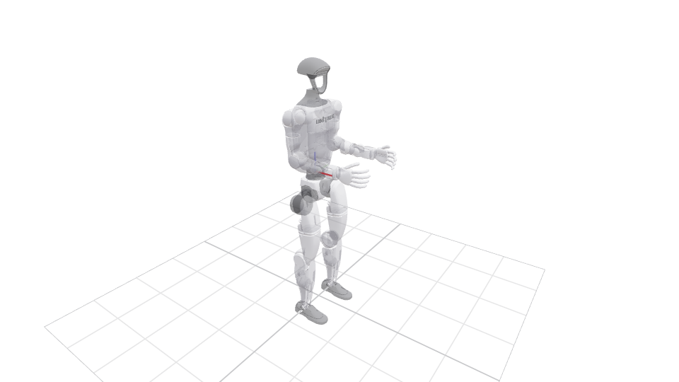

# Work with a floating-base robot

You load the Unitree G1 humanoid with a free-floating root, place its base in the world, and move it with
`Model.integrate`. After this page you know why `nq` and `nv` differ and how to handle it.

## Load the G1 with a free-flyer root

A humanoid is not bolted to the ground. `free_flyer=True` puts a `JointFreeFlyer` between the world and
the root body (the pelvis), so the base pose becomes part of the configuration:

```python
import torch
import better_robot as br
from robot_descriptions import g1_description
from better_robot.kinematics import forward_kinematics_state

model = br.load(g1_description.URDF_PATH, free_flyer=True, dtype=torch.float64)
print(model.joint_names[:3], type(model.joint_models[1]).__name__)
print("nq =", model.nq, "nv =", model.nv)  # 36, 35
```
```output
('universe', 'root_joint', 'pelvis_contour_joint') JointFreeFlyer
nq = 36 nv = 35
```

A floating base is just another joint in the tree: the same kinematics, dynamics and optimization code
handles fixed and floating robots.

## Read the configuration layout

The free-flyer's slice of `q` is a pose `[x, y, z, qx, qy, qz, qw]`: 7 numbers. Its velocity is a twist
`[linear(3), angular(3)]`: 6 numbers. The 29 actuated joints add one entry each to both, so
`nq = 7 + 29 = 36` and `nv = 6 + 29 = 35`.

```python
q = model.q_neutral.clone()
print(q[:7])   # base at the origin, identity quaternion (scalar last)
q[2] = 0.79    # lift the pelvis to standing height

state = forward_kinematics_state(model, q)
left_foot = model.frame_id("body_left_ankle_roll_link")
print(state.frame_translation[left_foot])  # ankle about 3 cm above the ground
```
```output
tensor([0., 0., 0., 0., 0., 0., 1.], dtype=torch.float64)
tensor([-2.3261e-06,  1.1851e-01,  3.3136e-02], dtype=torch.float64)
```

<figure markdown>
  { width="560" }
  <figcaption>The G1 humanoid: its root is a free-flyer joint, so the base pose is the first seven entries of `q`.</figcaption>
</figure>

## Move with integrate, not addition

Adding a velocity to `q` is wrong for the base: a quaternion plus a rotation vector is not a rotation.
`Model.integrate(q, v)` applies `v (..., nv)` on the configuration manifold, and `Model.difference(q0, q1)`
is its inverse: the `(..., nv)` velocity that takes `q0` to `q1` in unit time.

```python
v = torch.zeros(model.nv, dtype=torch.float64)
v[0] = 0.5   # move forward 0.5 m
v[5] = 1.0   # turn 1 rad about the vertical axis

q_next = model.integrate(q, v)
print(q_next[:7])  # x = 0.42, y = 0.23: an arc; the quaternion stays unit norm
print(torch.allclose(model.difference(q, q_next), v))
```
```output
tensor([0.4207, 0.2298, 0.7900, 0.0000, 0.0000, 0.4794, 0.8776],
       dtype=torch.float64)
True
```

The base twist is expressed in the base frame, so a rotating base moves along an arc, not a straight line.

## Jacobians have nv columns

A Jacobian maps velocities, so it has `nv` columns, not `nq`. The first six belong to the base twist,
the other 29 to the joints:

```python
from better_robot.kinematics import frame_jacobian

J = frame_jacobian(model, state, frame="body_left_ankle_roll_link")
print(J.shape)  # (6, 35)
assert J.shape == (6, model.nv)
```
```output
torch.Size([6, 35])
```

Moving the base by one unit along `v[0]` moves every frame by the same amount, so `J[:3, :3]` of any frame is
the base rotation, here the identity.

!!! note "Contract"
    Never add or subtract configurations directly. Use `Model.integrate` and `Model.difference`
    everywhere `nq != nv` is possible. Optimizers do this for you through `terms.RobotManifold`.

## Where next

- [Optimize a trajectory](trajectories.md) — many configurations at once, coupled in time.
- [Joints, bodies and frames](../concepts/joints-bodies-frames.md) — every joint type, including the free-flyer.
- [Lie groups and spatial algebra](../concepts/lie-and-spatial.md) — the math behind `integrate` and `difference`.
