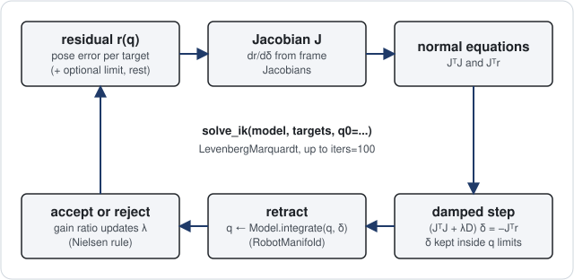
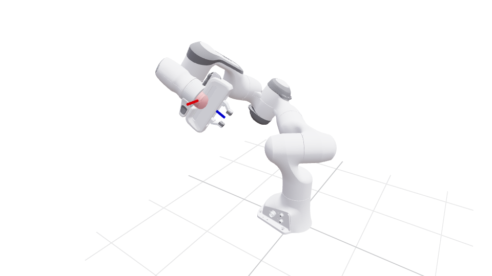

# Solve inverse kinematics

You find joint configurations that put the Panda hand at target poses, for a whole batch of targets at
once. Then you add your own cost term to the same problem.

## Make reachable targets

Start from the Panda of [the previous page](forward-kinematics.md). To be sure every target is reachable,
you sample random configurations and take their hand poses as targets:

```python
import torch
import better_robot as br
from robot_descriptions import panda_description
from better_robot import optim, terms
from better_robot.kinematics import forward_kinematics_state

FRAME = "body_panda_hand"
model = br.load(panda_description.URDF_PATH, dtype=torch.float64)
hand = model.frame_id(FRAME)
generator = torch.Generator().manual_seed(0)

q0 = model.q_neutral.clamp(model.lower_pos_limit, model.upper_pos_limit).expand(32, -1)
q_goal = terms.random_start(model, q0, generator=generator)
target = forward_kinematics_state(model, q_goal).frame_pose[:, hand]  # (32, 7)
```

`terms.random_start` redraws every bounded vector-space joint inside its limits for every row of `q0`; free-flyer,
spherical and unbounded joints keep their `q0` values.

## Solve with one call

`terms.solve_ik` builds a pose term per target frame, keeps the joints inside their limits, and runs
Levenberg-Marquardt (LM) on all 32 problems together. Each iteration evaluates the residual
$r(q)$ (pose error and limit violations) and its Jacobian $J = \partial r / \partial q$, then takes the
damped step $\Delta q = -(J^\top J + \lambda D)^{-1} J^\top r$, where $D = \mathrm{diag}(J^\top J)$ and
$\lambda$ grows when a step is rejected, then integrates it with `model.integrate`, so configurations
stay on the manifold:

{ width="860" }

*One LM iteration of `solve_ik`; the whole loop is batched over the 32 targets.*

`restarts` retries from random starts to escape local minima:

```python
result = terms.solve_ik(model, {FRAME: target}, q0=q0, restarts=4, generator=generator)
q = result.x["q"]  # (32, nq)

reached = forward_kinematics_state(model, q).frame_pose[:, hand]
error = (reached[:, :3] - target[:, :3]).norm(dim=-1)
print(f"reached (<0.1 mm): {float((error < 1e-4).float().mean()):.2f}, median error {float(error.median()):.1e} m")
```
```output
reached (<0.1 mm): 0.97, median error 2.3e-12 m
```

`result.x` is a dict of the solved variables; IK has one variable, `"q"`, and `result[name]` is shorthand for `result.x[name]`:

```python
q = result["q"]  # (32, nq)
assert q is result.x["q"]
```

<figure markdown>
  { width="860" }
  <figcaption>Start configuration (left) and the solved configuration reaching the target hand pose (right).</figcaption>
</figure>

## Add your own term

`terms.ik_problem` returns the same problem unsolved, an `optim.Problem`. A term is a plain function of
named tensors that returns a residual; its Jacobian comes from autograd. Here a weak term pulls the elbow
(joint 4, `q[:, 3]`) toward a preferred angle:

```python
problem = terms.ik_problem(model, {FRAME: target}, q0=q0)
problem.data["preferred_elbow"] = torch.tensor(-1.8, dtype=torch.float64)
problem.residual("elbow", lambda q, preferred_elbow: q[:, 3:4] - preferred_elbow, weight=1e-3)

result = optim.solve(problem, optim.LevenbergMarquardt(), iters=100)
for name, loss in problem.losses(result.x).items():
    print(f"{name}: {float(loss.mean()):.2e}")
```
```output
pose/body_panda_hand: 2.27e-02
elbow: 6.95e-04
```

The lambda's argument names select the tensors it receives: `q` is the variable, `preferred_elbow` comes
from `problem.data`.

## Swap the optimizer

The same problem runs under any `torch.optim` optimizer. Adam needs many more steps than LM:

```python
result = optim.solve(problem, optim.TorchOptim(torch.optim.Adam, lr=0.05), iters=300)
```

## Where next

- [Floating-base robots](floating-base.md) — the same `solve_ik` on a humanoid whose base is a joint.
- [Optimization](../concepts/optimization.md) — problems, terms and solvers in depth.
- [Write a term](../guides/write-a-term.md) — residual shapes, weights and Jacobians for your own terms.
