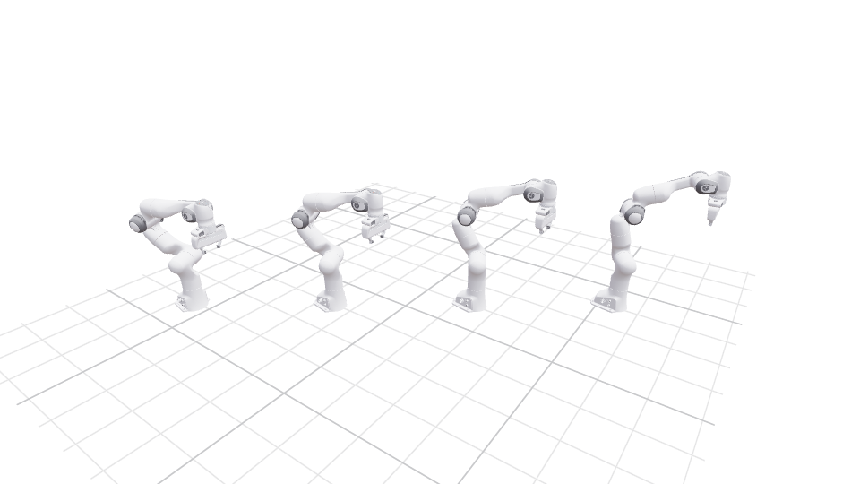

# Optimize a trajectory

You optimize a whole Panda motion at once: 20 configurations (knots) that start at a ready pose, end at a
hand target, and move smoothly in between. After this page you can set up a time-indexed problem.

## Set up start and goal

Continue with the Panda. The start is a "ready" configuration; the goal moves the hand 10–15 cm:

```python
import math
import torch
import better_robot as br
from robot_descriptions import panda_description
from better_robot import optim, terms
from better_robot.kinematics import forward_kinematics_state

FRAME, KNOTS, DT = "body_panda_hand", 20, 0.05
READY = [0.0, -math.pi / 4, 0.0, -3 * math.pi / 4, 0.0, math.pi / 2, math.pi / 4, 0.04]

model = br.load(panda_description.URDF_PATH, dtype=torch.float64)
hand = model.frame_id(FRAME)
q_start = torch.tensor(READY, dtype=torch.float64).clamp(model.lower_pos_limit, model.upper_pos_limit)
pose_start = forward_kinematics_state(model, q_start[None]).frame_pose[0, hand]
pose_goal = pose_start.clone()
pose_goal[:3] += torch.tensor([0.10, 0.15, 0.15], dtype=torch.float64)
```

## Weight the pose term per knot

The variable is `q (1, KNOTS, nq)`: one trajectory with a time axis. A pose target exists for every knot,
but a weight per knot switches it on only at the first and last knot:

```python
target = pose_start.repeat(1, KNOTS, 1)  # (1, KNOTS, 7)
target[:, -1] = pose_goal
end_weight = torch.zeros(KNOTS, 1, dtype=torch.float64)
end_weight[0], end_weight[-1] = 1e6, 1e4
```

## Build the problem

`time=("q",)` tells the problem that axis -2 of `q` is time. Terms that couple neighbouring knots then
produce a banded Jacobian, which LM solves in time linear in the number of knots:

```python
problem = optim.Problem(
    {"q": q_start.repeat(1, KNOTS, 1)},
    manifolds={"q": terms.RobotManifold(model)},
    bounds={"q": (model.lower_pos_limit, model.upper_pos_limit)},
    data={"target": target},
    time=("q",),
)
problem.cached(terms.kinematic_state(model), name="state")
problem.residual("ends", terms.frame_pose(model, FRAME, target="target"), weight=end_weight, window=1)
problem.residual("velocity", terms.finite_difference(model, order=1, dt=DT), weight=1e-3)
problem.residual("acceleration", terms.finite_difference(model, order=2, dt=DT), weight=1e-4)
```

Each piece does one job:

- `RobotManifold` updates `q` with `Model.integrate`, so the same code works for a floating base.
- `bounds` keeps every knot inside the joint limits.
- `problem.cached` computes the `KinematicState` once per step and shares it between terms.
- `window=1` evaluates the pose term knot by knot; `finite_difference` couples 2 or 3 neighbouring knots.

## Solve and check

```python
result = optim.solve(problem, optim.LevenbergMarquardt(), iters=200)
q = result.x["q"][0]  # (KNOTS, nq)

reached = forward_kinematics_state(model, q).frame_pose[:, hand]
print(f"{result.iters} LM steps, goal error {float((reached[-1, :3] - pose_goal[:3]).norm()):.1e} m")
print(f"peak joint speed {float(((q[1:] - q[:-1]) / DT).abs().max()):.2f} rad/s")
```



[Time and structure](../concepts/time-and-structure.md) explains windows and banded solves.
Next: [run it on a GPU and in batches](gpu-and-batching.md).
