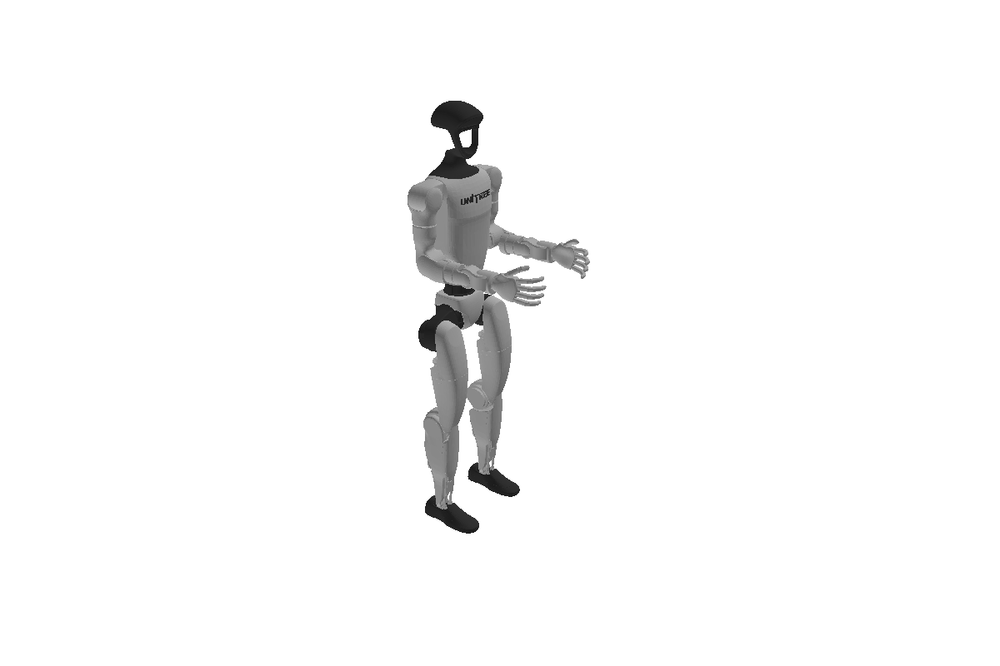

# Load a robot from URDF, MJCF or code

`better_robot.load` turns a URDF file, an MJCF file or a programmatic builder into a frozen
[`Model`](../reference/glossary.md#robot-model). This guide shows each path, how to add a floating base,
how to look up joint and frame names, and what the common load errors mean.

## Load a URDF

Pass a path. The format is picked from the file extension (`format="auto"`); pass
`format="urdf"` or `format="mjcf"` to force it.

```python
import torch
import better_robot as br
from robot_descriptions import panda_description

model = br.load(panda_description.URDF_PATH, dtype=torch.float64)
print(model.nq, model.nv, model.njoints)
```
```output
8 8 14
```

`dtype` defaults to `torch.float32`; `device=` places every model tensor on one device.
[`robot_descriptions`](https://github.com/robot-descriptions/robot_descriptions.py) is an optional
dependency (`pip install "better-robot[demos]"`) that downloads common robot descriptions on first use.
Any URDF path on disk works the same way.

## Load an MJCF file

MuJoCo compiles the file and `load` reads the compiled model, so body placements, joint ranges in the
file's angle unit, `limited="auto"` and `euler`/`axisangle` orientations come out as MuJoCo computes them
(`tests/parity/mujoco/` checks them against `mj_kinematics`). It needs the `mjcf` extra
(`pip install "better-robot[mjcf]"`); without it, `load` raises `OptionalDependencyError`. A body carries
at most one joint, and names are required on every body, joint and site.

```python { .no-run }
model = br.load("scene.xml")              # .xml / .mjcf picks the MJCF parser
model = br.load("robot.xml", format="mjcf")
```

## Add a floating base

A floating base is one more joint, a `JointFreeFlyer`, at the root of the tree. It adds 7
configuration entries (position and a scalar-last quaternion) and 6 velocity entries, so `nq` and `nv`
differ. Use `kinematics.integrate` and `kinematics.difference` instead of adding to `q`.

{ width=560 }

*The G1 with `free_flyer=True`: the first seven entries of `q` place the pelvis in the world.*

```python
floating = br.load(panda_description.URDF_PATH, free_flyer=True, dtype=torch.float64)
print(floating.nq - model.nq, floating.nv - model.nv)  # 7 6
q0 = floating.q_neutral
print(q0[:7])  # identity base pose: [0, 0, 0, 0, 0, 0, 1]
```
```output
7 6
tensor([0., 0., 0., 0., 0., 0., 1.], dtype=torch.float64)
```

`free_flyer=True` is a shortcut for `root_joint=JointFreeFlyer()`; pass `root_joint=` for any other
root joint model.

## Build a model in code

`ModelBuilder` needs no files and no optional packages. Add bodies, connect them with joints, then
build the `Model`.

```python
builder = br.ModelBuilder("pendulum")
builder.add_body("base", mass=0.0)
builder.add_body("link", mass=2.0, com=torch.tensor([0.3, 0.0, 0.0]),
                 inertia=torch.diag(torch.tensor([0.2, 0.3, 0.4])))
builder.add_revolute("shoulder", axis=(0.0, 1.0, 0.0), parent="base", child="link",
                       origin=torch.tensor([0.0, 0.0, 0.0, 0.0, 0.0, 0.0, 1.0]),
                       lower=-2.0, upper=2.0)
pendulum = br.io.build_model(builder.finalize(), dtype=torch.float64)
print(pendulum.joint_names)
```
```output
('universe', 'root_joint', 'shoulder')
```

`origin` is a pose `[tx, ty, tz, qx, qy, qz, qw]` with the quaternion scalar last.

## Look up joints and frames by name

The model's static fields hold the topology (names, parents, index tables); its tensor fields hold the
differentiable data (joint placements, body inertias, frame placements). Names resolve to integer ids
once, outside any hot loop.

```python
print(model.joint_names[:3])
hand = model.frame_id("panda_hand")
joint = model.joint_id("panda_joint4")
print(hand, joint, model.frame_names[hand])
```
```output
('universe', 'root_joint', 'panda_joint1')
10 5 panda_hand
```

Every link gets a frame of its own name; print `model.frame_names` to see
them all. An unknown name raises `UnknownNameError` (a `KeyError`). Functions that take a frame, such as `frame_jacobian`,
accept either the id or the name.

## Meshes

Visual and collision meshes are loaded lazily by the viewer and the collision layer. Mesh files other
than primitives need the `meshes` extra (`pip install "better-robot[meshes]"`, which installs
`trimesh`). Kinematics and dynamics never read meshes.

## Common errors

Errors raised by the library's own checks derive from `better_robot.exceptions.BetterRobotError` and
from the matching built-in (`ValueError`, `KeyError`, `ImportError`), so `except ValueError` keeps
working. Loading also lets plain Python errors through: a missing file is a `FileNotFoundError`. The
ones you meet when loading or first using a model:

| Error | Raised when |
|-------|-------------|
| `OptionalDependencyError` | an optional package (`mujoco`, `trimesh`, `viser`) is missing; the message names the install command |
| `ModelError` | the description cannot be mapped to a model: an unknown joint kind, a cycle in the tree, a mimic chain that loops, joints whose `nq` / `nv` do not add up |
| `ShapeError` | a tensor's trailing axes do not match the model, e.g. `q` is not `(B..., nq)` |
| `DtypeMismatchError` / `DeviceMismatchError` | an input tensor's dtype or device differs from the model's |

Validation happens at public functions, so a wrong `q` fails at the call, with the expected shape in
the message:

```python
from better_robot.exceptions import ShapeError
from better_robot.kinematics import forward_kinematics

try:
    forward_kinematics(model, torch.zeros(model.nq + 1, dtype=torch.float64))
except ShapeError as error:
    print(type(error).__name__)
```
```output
ShapeError
```

## Where next

- [Kinematics and Jacobians](../concepts/kinematics-and-jacobians.md): run forward kinematics on the loaded model.
- [Joints, bodies and frames](../concepts/joints-bodies-frames.md): what the names you looked up refer to.
- [Model and state](../concepts/model-and-state.md): why the loaded `Model` is frozen.
