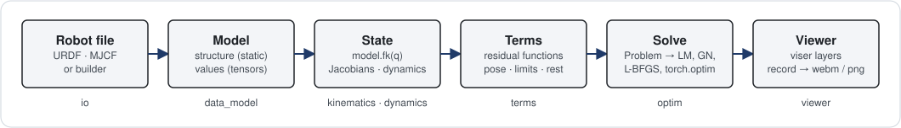
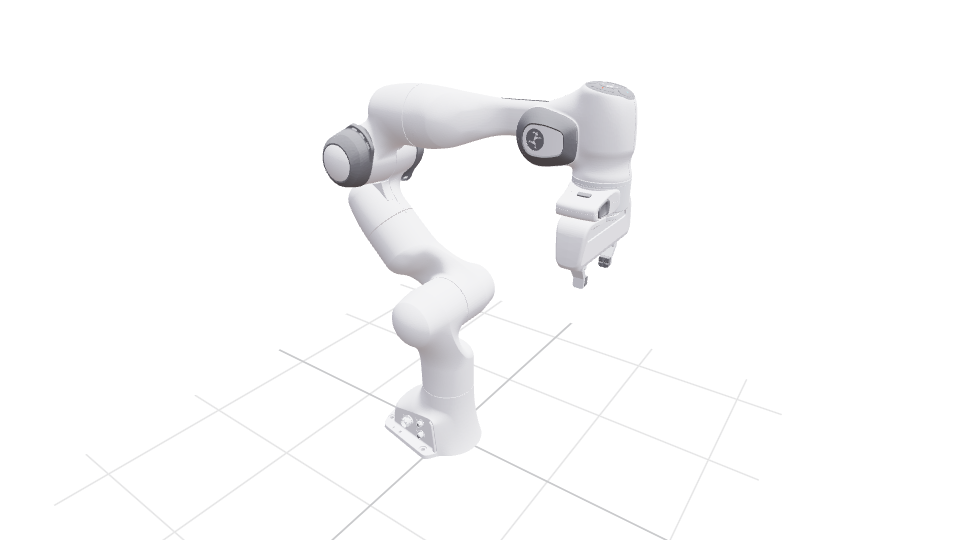

# BetterRobot

BetterRobot is a PyTorch-native robotics library. After this page you will know what the library
is made of, see one complete inverse-kinematics (IK) solve on a batch of targets, and know which
section of the docs to open next.

{ width="960" }

*Every workflow in BetterRobot is this one pipeline: describe, query, score, solve, look.*

## What BetterRobot is

- **A robot is a `Model`.** `br.load(path)` reads a URDF, MJCF or programmatic description into an
  immutable `Model`: joints, bodies and frames (the static topology) plus the differentiable tensors
  that parametrize them. A floating base is just one more joint, a `JointFreeFlyer`.
- **A query returns a `KinematicState`.** `model.fk(q)` runs forward kinematics for a configuration
  `q` and returns a frozen state with every body and frame pose. Jacobians and dynamics
  (`frame_jacobian`, `inverse_dynamics`) are functions of that state, never hidden caches.
- **Everything is batched and differentiable.** `q` may carry any leading batch axes
  (`(B, nq)`, `(B, T, nq)`, ...); results keep them. Autograd flows through every step, on CPU or GPU,
  in float32 or float64, without silent casts or device moves.
- **Optimization is generic.** `better_robot.optim` knows nothing about robots: a `Problem` holds
  named tensors and plain-function terms, and Levenberg-Marquardt, Gauss-Newton, L-BFGS or any
  `torch.optim` optimizer solves it. The robot-specific terms (pose targets, joint limits,
  collision) live in `better_robot.terms`, together with `solve_ik`.
- **Seeing the result is one call.** The viewer shows robots, trajectories and point layers in the
  browser or records them to a video file without one.

The same API covers a fixed-base arm and a floating-base humanoid; the pages below follow one story
from a loaded Panda to a visualized, batched, GPU-solved trajectory.

## One batched IK solve

```python
import torch
from robot_descriptions import panda_description

import better_robot as br
from better_robot import terms

model = br.load(panda_description.URDF_PATH, dtype=torch.float64)
hand = model.frame_id("body_panda_hand")

# A batch of 64 reachable hand poses, made from random configurations.
generator = torch.Generator().manual_seed(0)
q0 = model.q_neutral.clamp(model.lower_pos_limit, model.upper_pos_limit).expand(64, -1)
targets = model.fk(terms.random_start(model, q0, generator=generator)).frame_pose[:, hand]

# Solve all 64 inverse-kinematics problems at once, then check them with forward kinematics.
result = terms.solve_ik(model, {"body_panda_hand": targets}, q0=q0, restarts=4, generator=generator)
reached = model.fk(result["q"]).frame_pose[:, hand]
error = (reached[:, :3] - targets[:, :3]).norm(dim=-1)
print(f"median hand position error: {float(error.median()):.1e} m")
```
```output
median hand position error: 3.1e-12 m
```

Sixty-four targets, one solver call, one batched forward-kinematics check. The batch axis never
appears in the code; it rides along in `q0` and `targets`.

<figure markdown>
  { width="560" }
  <figcaption>The Panda at its neutral configuration, hand frame shown.</figcaption>
</figure>

## Where next

<div class="grid cards" markdown>

-   **Getting started**

    ---

    Install, load the Panda, run forward and inverse kinematics, add a floating base, optimize a
    trajectory, batch it on a GPU and watch it in the viewer. One story, eight short pages.

    [Start here](getting-started/installation.md)

-   **Concepts**

    ---

    How the model, kinematic state, Lie algebra, dynamics, optimization and viewer layers fit
    together, with one figure per idea.

    [Read the concepts](concepts/architecture.md)

-   **Reference**

    ---

    Every public function and class, the glossary, the changelog and the roadmap.

    [Open the API](reference/api/better_robot.md)

</div>
