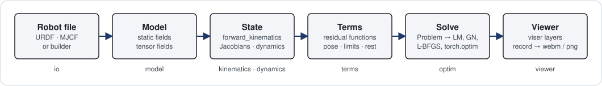

# BetterRobot

BetterRobot is a PyTorch library for robot kinematics, dynamics and optimization. Every function works on a whole
batch of configurations at once, runs on CPU or GPU, and lets gradients flow through.

The idea is one short pipeline. You load a robot into a `Model`. Forward kinematics turns a configuration into a
`KinematicState`, and Jacobians, dynamics and collision distances are functions of that state. Inverse kinematics,
trajectories and motion fits are least-squares problems you build from small terms and hand to a solver. A browser
viewer shows the result or records it to a video.

{ width="960" }

Here is the whole pipeline in one go: 64 inverse-kinematics problems for the Franka Panda, solved in one call.

```python
import torch
from robot_descriptions import panda_description

import better_robot as br
from better_robot import terms

model = br.load(panda_description.URDF_PATH, dtype=torch.float64)
generator = torch.Generator().manual_seed(0)
q0 = model.q_neutral.expand(64, -1)

# 64 reachable hand poses, made from random configurations.
targets = br.forward_kinematics(model, terms.random_start(model, q0, generator=generator)).frame_pose_of("panda_hand")

result = br.solve_ik(model, {"panda_hand": targets}, q0=q0, seeds=8, generator=generator)
reached = br.forward_kinematics(model, result.x["q"]).frame_pose_of("panda_hand")
error = (reached[:, :3] - targets[:, :3]).norm(dim=-1)
print(f"median hand error: {float(error.median()):.1e} m")
```
```output
median hand error: 5.0e-13 m
```

The batch never shows up in the code: it rides along in `q0` and `targets`.

## The modules

| Page | Packages | What you do with them |
|---|---|---|
| [Model and io](model-and-io.md) | `model`, `io` | load a URDF or MJCF file, or write a robot in code |
| [Lie and spatial](lie-and-spatial.md) | `lie`, `spatial` | compose poses, exp and log maps, inertias and 6D vectors |
| [Kinematics](kinematics.md) | `kinematics` | frame poses, Jacobians, stepping a configuration |
| [Dynamics](dynamics.md) | `dynamics` | joint torques, mass matrix, accelerations, centre of mass |
| [Optimization and terms](optim-and-terms.md) | `optim`, `terms` | inverse kinematics, trajectories, your own least-squares problems |
| [Collision](collision.md) | `collision` | spheres on the robot, distances to itself and to obstacles |
| [Viewer](viewer.md) | `viewer` | show robots in the browser, record videos |
| [Errors and testing](errors-and-testing.md) | `exceptions`, `testing` | the error classes, helpers for your own tests |

Start with [Install and quickstart](install.md).
