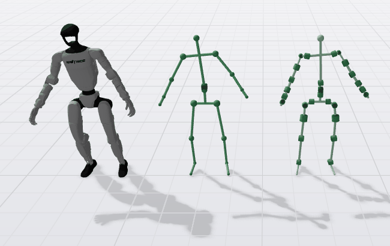

# Viewer

The viewer shows robots, point clouds, frames and whole motion clips in your browser, through
[viser](https://viser.studio). Everything you add is a layer. All layers share one timeline, so a clip of `T`
configurations plays with a slider. `viewer.record` writes the scene to an `.mp4` or `.webm` video, or a `.png`
still, without opening a browser.

The names you will use:

| Name | What it does |
|---|---|
| `br.Viewer()` | starts the viser server and the scene |
| `viewer.RobotVisual(model, q)` | a robot layer; `q` is one configuration `(nq,)` or a clip `(T, nq)` |
| `viewer.add(layer, tags=, pose=)` | adds a layer; tags let you hide or remove groups of layers |
| `viewer.show(step)`, `viewer.serve()` | jump to a step; keep the page open until Ctrl-C |
| `viewer.record(path)` | writes a video or a still through a headless Chromium |
| `viewer.MINIMAL`, `viewer.MEDIUM` | the two skeleton styles, which need no mesh files |

A robot draws in one of three styles: `"meshes"` (the robot's own mesh files), `"medium"` (a skeleton with one
glyph per joint on thin rods) and `"minimal"` (a stick figure). The skeleton styles need only the model.

{ width="650" }

## Show a robot

```python
import torch
from robot_descriptions import panda_description

import better_robot as br
from better_robot.viewer import RobotVisual

model = br.load(panda_description.URDF_PATH, dtype=torch.float64)
geometry = br.io.load_geometry(panda_description.URDF_PATH, model)
clip = model.q_neutral.repeat(30, 1)  # (T, nq): swing the first joint
clip[:, 0] = torch.linspace(-1.0, 1.0, 30, dtype=torch.float64)

viewer = br.Viewer()
robot = viewer.add(RobotVisual(model, clip, geometry=geometry, root=panda_description.URDF_PATH))
viewer.show(15)
print(robot.style, viewer.timeline.nsteps)
```
```output
meshes 30
```

Open the printed `viewer.url` in a browser to see it. In a script, end with `viewer.serve()` so the page stays up;
Ctrl-C pauses playback and `serve` returns, so the script ends without a traceback:

```python { .no-run data-reason="blocks until Ctrl-C" }
viewer.serve()
```

## The skeleton styles

Add two more Pandas beside the first, one per skeleton style. Tags name them for later.

```python
viewer.add(RobotVisual(model, clip, name="minimal", style="minimal"), tags="skeletons", pose=[0.0, 0.8, 0.0, 0.0, 0.0, 0.0, 1.0])
viewer.add(RobotVisual(model, clip, name="medium", style="medium"), tags="skeletons", pose=[0.0, 1.6, 0.0, 0.0, 0.0, 0.0, 1.0])
print(len(viewer.layers))
viewer.remove("skeletons")
print(len(viewer.layers))
```
```output
4
2
```

## Record a video

```python { .no-run data-reason="records through a headless Chromium; tests/viewer/test_record.py runs record" }
viewer.record("panda_swing.mp4")                                  # 1920 x 1080, every step
viewer.record("panda_still.png", steps=[15], size=(1280, 720))    # one still
```

See also: `examples/viewer/` in the repository, from a showcase of eight robots to interactive avoidance demos.
